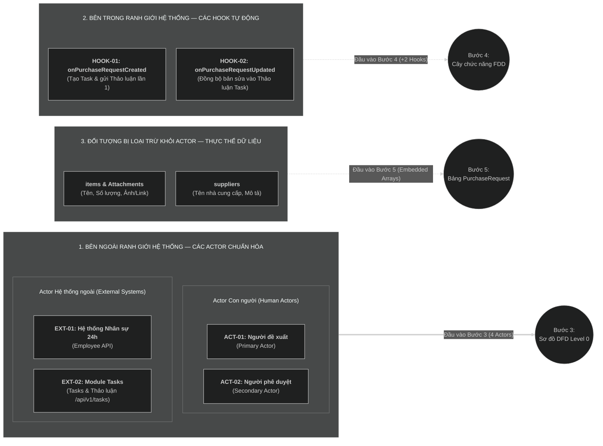

# BƯỚC 2: TRUY VẾT & BÓC TÁCH TÁC NHÂN (ACTOR IDENTIFICATION) — MODULE ĐỀ XUẤT MUA SẮM THIẾT BỊ

> **Tài liệu nguồn (Bước 1):** [`md/analysis/1-problem-survey.md`](./1-problem-survey.md)  
> **Quy chuẩn áp dụng:** [`.agents/rules/2-analysis/2_actor_identification_7_questions.md`](../../.agents/rules/2-analysis/2_actor_identification_7_questions.md)  
> **Đầu ra làm cơ sở cho:**
> - Bước 3 — Thiết kế Sơ đồ Ngữ cảnh DFD Level 0 (`md/analysis/3-dfd-context-diagram.md`)
> - Bước 4 — Sơ đồ Phân rã Chức năng FDD 3 Cấp & RBAC (`md/analysis/4-fdd-and-rbac.md`)
> - Bước 5 — Thiết kế Cơ sở Dữ liệu (`md/analysis/db/5-database-design.md`)

---

## 1. Kết quả Quét 7 Câu hỏi Truy vết Actor (Từ kết quả 5 Câu hỏi Khảo sát ở Bước 1)

| Thứ tự | Câu hỏi truy vết Actor | Tìm đối tượng nào? | Nguồn dữ liệu từ Bước 1 (`1-problem-survey.md`) | Kết quả phân tích & Đáp án đã chốt |
|:---:|---|---|---|---|
| **Câu 1** | **Ai trực tiếp đưa dữ liệu mới vào hệ thống?** | Primary Actor (Người nhập liệu, khởi phát quy trình) | Câu 2 (Quy trình hiện tại) & Câu 4 (Ai sử dụng) | **`ACT-01`: Người đề xuất (Nhân sự)** — Nhân viên nội bộ 24h Group trực tiếp tạo mới phiếu Đề xuất mua sắm trên giao diện Module Đề xuất (`revision = 1`, hệ thống tự lấy hồ sơ cá nhân từ `req.auth`), cập nhật phiếu khi đang ở trạng thái `PENDING` (`revision + 1`), và xem thống kê / danh sách các phiếu đề xuất liên quan. |
| **Câu 2** | **Ai tiếp nhận, duyệt hoặc xử lý bước tiếp theo?** | Secondary Actor (Người xử lý quy trình kế tiếp) | Câu 3 (Vấn đề quy trình) & Câu 4 (Ai sử dụng) | **`ACT-02`: Người phê duyệt** — Nhân viên được chọn vào trường `employee_approver_id` trên phiếu: • **Khi duyệt & thảo luận:** `ACT-02` **không đi vào Module Đề xuất mua sắm**, mà vào **Module Tasks** (vì ngay khi tạo phiếu, 1 Task duyệt đề xuất đã xuất hiện trong *"Công việc của tôi"* của `ACT-02`). Tại đây, `ACT-02` đọc nội dung đề xuất trong tab **Trao đổi & Thảo luận**, trao đổi trực tiếp và bấm **`Phê duyệt` (`APPROVED`)** / **`Từ chối` (`REJECTED`)** ngay trên giao diện Task. • **Khi vào Module Đề xuất mua sắm:** `ACT-02` chỉ vào để **Xem thống kê & danh sách các đề xuất** liên quan đến mình. |
| **Câu 3** | **Ai xem báo cáo, giám sát và ra quyết định?** | Supervisory Actor (Người quản lý, giám sát, đối soát) | Câu 4 (Ai sử dụng), Câu 5 & `QĐ-01` | **Không tách Supervisory Actor riêng trên Module Đề xuất mua sắm:** Quyền quyết định duyệt thuộc về **`ACT-02`**, còn toàn bộ luồng theo dõi/thảo luận của các thành viên **nhóm Ban Giám Đốc (BGĐ)** diễn ra bên **Module Tasks sẵn có** (được gắn tự động làm `watchers` qua `BGD_GROUP_ID`) và xem danh sách/thống kê chung. |
| **Câu 4** | **Khách hàng / Người dùng cuối tương tác trực tiếp hay gián tiếp?** | Self-service User vs Data Entity | Câu 2 (Kênh tiếp nhận) & Câu 4 (Ai sử dụng) | • Nhân sự nội bộ (`ACT-01: Người đề xuất`, `ACT-02: Người phê duyệt`) là **Self-service User** thao tác trực tiếp. • **Thiết bị đề xuất (`items` kèm `Attachments`)** và **Nhà cung cấp (`suppliers`)** không đăng nhập hay tương tác trực tiếp mà do `ACT-01` nhập vào phiếu ➔ **Loại trừ khỏi Actor**, chuyển thành **Thực thể dữ liệu (`Data Entity`)** nhúng trong bảng `PurchaseRequest` ở Bước 5. |
| **Câu 5** | **Hệ thống có trao đổi dữ liệu tự động với bên thứ 3 nào không?** | External System Actor (Hệ thống/Dịch vụ tích hợp API) | Câu 1 (Ranh giới hệ thống), Câu 5 & `QĐ-01`, `QĐ-03` | Có **2 Actor Hệ thống ngoài (`External Systems`)** trong hệ sinh thái 24h Group giao tiếp qua API: 1. **`EXT-01`: Hệ thống Nhân sự 24h (`Employee API`)** — Kiểm tra `employee_approver_id` hợp lệ và cung cấp thông tin họ tên, chức vụ, chi nhánh theo danh sách `_id` (`employee_id`, `employee_approver_id`). *(Lưu ý: Hồ sơ người tạo lấy sẵn từ `req.auth`; ô chọn nhân viên và upload ảnh trên form dùng trực tiếp API helper sẵn có của hệ thống).* 2. **`EXT-02`: Module Tasks (`Tasks Service - /api/v1/tasks`)** — Nhận cuộc gọi từ **Hook đồng bộ** của Module Đề xuất để tạo Task duyệt đề xuất & ghi nội dung phiếu (`revision = 1` và các bản cập nhật `revision + 1`) vào tab **Trao đổi & Thảo luận** của Task; đồng thời gửi quyết định **`Phê duyệt` / `Từ chối`** của `ACT-02` từ giao diện Task về cập nhật trạng thái bảng `PurchaseRequest`. |
| **Câu 6** | **Có nghiệp vụ nào tự động chạy ngầm / Hook nội bộ theo sự kiện không?** | Automated Process / Internal Hook (Cron job, Queue, Event Hook) | Câu 3 (Khâu thủ công cần tự động hóa) & Kiến trúc Hook đồng bộ | Có **`2` Hook đồng bộ tự động nội bộ (`Event-driven Hooks`)** nằm bên trong ranh giới hệ thống để tách bạch phần Core Đề xuất và phần Đồng bộ Tasks: 1. **`HOOK-01` (`onPurchaseRequestCreated`):** Tự động kích hoạt ngay sau khi tạo mới phiếu (`revision = 1`) ➔ gọi API Module Tasks tạo Công việc (gán `ACT-02` nhận việc, nhóm `BGĐ` theo dõi) và đẩy nội dung chi tiết phiếu lần 1 vào tab **Trao đổi & Thảo luận** của Task. 2. **`HOOK-02` (`onPurchaseRequestUpdated`):** Tự động kích hoạt ngay sau khi cập nhật phiếu (`revision + 1`) ➔ định dạng nội dung bản sửa mới và gọi API Module Tasks thêm bình luận mới vào tab **Trao đổi & Thảo luận** của Task liên kết. |
| **Câu 7** | **Ai quản trị tài khoản, phân quyền và cấu hình nền tảng?** | System Admin (Quản trị viên hệ thống) | Câu 4 & Quyết định kiến trúc `QĐ-01`, `QĐ-03` | **Không sinh Actor Quản trị viên (`System Admin`) riêng trong phạm vi Module Đề xuất mua sắm:** Tài khoản nhân sự thuộc `EXT-01`, thành viên nhóm BGĐ quản lý động bên `EXT-02`, và `_id` nhóm BGĐ được khai báo hằng số (`BGD_GROUP_ID`). Quyền thao tác phân định động theo `employee_id` và `employee_approver_id` trên từng phiếu. |

---

## 2. Áp dụng 4 Quy tắc Chuẩn hóa & Loại trừ Sai lầm

1. **Quy tắc 1 — Gộp chức danh trùng quyền & Loại bỏ bước phụ trợ trên Form:**
   - Gộp mọi nhân viên khi lập/sửa phiếu dự trù thành **`ACT-01: Người đề xuất`**; gộp mọi nhân sự được chỉ định vào `employee_approver_id` thành **`ACT-02: Người phê duyệt`**.
   - Các bước phụ trợ ngay trên Form (đọc `req.auth` tự điền thông tin cá nhân, gõ tìm nhân viên trong ô dropdown có sẵn, upload ảnh đính kèm) là logic xử lý bên trong bước Tạo/Sửa phiếu, **không tách thành hành động Actor độc lập**.
2. **Quy tắc 2 — Phân biệt Actor vs Data Entity:**
   - **Thiết bị đề xuất (`items` & `Attachments`)** và **Nhà cung cấp (`suppliers`)** chỉ là dữ liệu trên chứng từ ➔ Loại khỏi Actor, đưa vào **Bảng 3 (`Data Entity`)** để nhúng vào bảng `PurchaseRequest` ở Bước 5.
3. **Quy tắc 3 — Phân định đúng điểm chạm giữa Module Đề xuất và `EXT-02: Module Tasks`:**
   - `ACT-02` thực hiện xem chi tiết nội dung đề xuất, thảo luận và bấm `Phê duyệt / Từ chối` ngay trong giao diện **`EXT-02: Module Tasks`**; `ACT-02` chỉ truy cập trực tiếp vào Module Đề xuất khi xem thống kê và danh sách các đề xuất của mình.
4. **Quy tắc 4 — Tác vụ tự động / Hook nội bộ KHÔNG phải là Actor trên DFD Level 0:**
   - Hai Hook sự kiện **`HOOK-01` (`onCreated`)** và **`HOOK-02` (`onUpdated`)** nằm **bên trong** ranh giới hệ thống nên không vẽ thành Actor bên ngoài trên DFD Level 0, nhưng được lập riêng tại **Bảng 2** để bắt buộc ánh xạ thành các khối chức năng độc lập trên **Sơ đồ FDD ở Bước 4** (tách bạch rõ ranh giới giữa phần quản lý phiếu đề xuất và phần tích hợp Module Tasks).

---

## 3. Các Bảng Tổng hợp Truy vết (Đầu vào cho Bước 3, Bước 4, Bước 5)

### 3.1. Bảng 1: Danh sách Actor Chuẩn hóa (Bên ngoài Ranh giới Hệ thống ➔ Đầu vào Bước 3: DFD Level 0)

| Mã Actor | Tên Actor chuẩn hóa | Nhóm Actor | Phân loại Vai trò | Nguồn truy vết | Trách nhiệm & Luồng tương tác chính với Module Đề xuất mua sắm |
|:---:|---|---|---|---|---|
| **`ACT-01`** | **Người đề xuất** *(Proposer)* | Actor Con người *(Human Actor)* | Primary Actor | Câu 1, Câu 4 | Tạo mới phiếu Đề xuất mua sắm (`revision = 1`); cập nhật phiếu khi đang ở trạng thái `PENDING` (`revision + 1`); xem thống kê và danh sách các phiếu đề xuất liên quan (kèm link mở sang Task). |
| **`ACT-02`** | **Người phê duyệt** *(Approver)* | Actor Con người *(Human Actor)* | Secondary Actor | Câu 2, Câu 3, Câu 4 | **Trên Module Đề xuất:** Chỉ vào xem thống kê và danh sách các đề xuất mà mình liên quan/duyệt. **Trên Module Tasks:** Xem nội dung đề xuất trong tab *Trao đổi & Thảo luận*, thảo luận và bấm *Phê duyệt / Từ chối*. |
| **`EXT-01`** | **Hệ thống Nhân sự 24h** *(24h Employee API)* | Actor Hệ thống ngoài *(External System)* | External Data Provider | Câu 5, Câu 7 | Xác thực `employee_approver_id` hợp lệ khi tạo/sửa phiếu và cung cấp họ tên, chức vụ, chi nhánh nhân sự theo danh sách `_id` phục vụ hiển thị danh sách & định dạng nội dung thảo luận. |
| **`EXT-02`** | **Module Tasks** *(Tasks Service `/api/v1/tasks`)* | Actor Hệ thống ngoài *(External System)* | External Integration & Approval Workspace | Câu 2, Câu 5, Câu 6 | Nhận cuộc gọi từ Hook đồng bộ để: (1) Tạo Task duyệt đề xuất (`ACT-02` nhận việc, `BGĐ` theo dõi) & đẩy nội dung phiếu (`revision = 1`) vào Thảo luận Task; (2) Đẩy nội dung bản sửa mới (`revision + 1`) vào Thảo luận Task; (3) Chuyển quyết định `Phê duyệt / Từ chối` từ UI Task về cập nhật `PurchaseRequest` & ghi kết quả lên Task. |

---

### 3.2. Bảng 2: Danh sách Hook Tự động Nội bộ (Bên trong Ranh giới Hệ thống ➔ Đầu vào Bước 4: FDD)

| Mã Hook | Tên Hook tự động nội bộ (Event Hook) | Sự kiện kích hoạt | Nguồn truy vết | Ghi chú ánh xạ sang Bước 4 (FDD) |
|:---:|---|---|---|---|
| **`HOOK-01`** | **Hook khởi tạo Task & đẩy đề xuất lần đầu vào Thảo luận** *(`onPurchaseRequestCreated`)* | Ngay sau khi lưu phiếu mới (`revision = 1`) | Câu 6 | Gọi API Module Tasks tạo Task duyệt đề xuất, trả về `task_id` và đẩy nội dung phiếu lần 1 vào tab `Trao đổi & Thảo luận`. Cộng **`+1`** chức năng vào FDD Cấp 2. |
| **`HOOK-02`** | **Hook đồng bộ bản cập nhật đề xuất vào Thảo luận Task** *(`onPurchaseRequestUpdated`)* | Ngay sau khi cập nhật phiếu (`revision + 1`) | Câu 6 | Định dạng nội dung phiếu bản sửa mới và gọi API Module Tasks thêm vào tab `Trao đổi & Thảo luận` của `task_id` (đồng bộ lại hạn chót/người duyệt nếu đổi). Cộng **`+1`** chức năng vào FDD Cấp 2. |

---

### 3.3. Bảng 3: Đối tượng bị Loại trừ khỏi Actor ➔ Chuyển thành Thực thể Dữ liệu (Đầu vào Bước 5: Database)

| STT | Tên đối tượng bị loại trừ | Nguồn xuất hiện trong đề bài | Lý do loại trừ khỏi Actor | Hướng ánh xạ sang Bước 5 (Thiết kế Database) |
|:---:|---|---|---|---|
| **1** | **Thiết bị đề xuất & Đính kèm** *(`items` & `Attachments`)* | *"Nội dung đề xuất mua sắm: có thể có nhiều sản phẩm, mỗi sản phẩm có Tên, Số lượng, Hình ảnh hoặc link đính kèm"* | Không tự thao tác trên hệ thống; chỉ là danh sách mặt hàng dự trù và link/ảnh minh họa do `ACT-01` nhập vào phiếu. | Ánh xạ thành mảng subdocument `items[]` (bên trong chứa `attachments[]`) nhúng trong bảng **`PurchaseRequest`**. |
| **2** | **Nhà cung cấp** *(`suppliers`)* | *"Danh sách nhà cung cấp: Có thể có nhiều nhà cung cấp (Tên, mô tả)"* | Đối tác không đăng nhập hệ thống; chỉ là thông tin tham khảo (`name`, `description`) do `ACT-01` nhập vào phiếu. | Ánh xạ thành mảng subdocument `suppliers[]` nhúng trong bảng **`PurchaseRequest`**. |

---

## 4. Sơ đồ Phân loại Actor & Ranh giới Hệ thống (Traceability Diagram)

