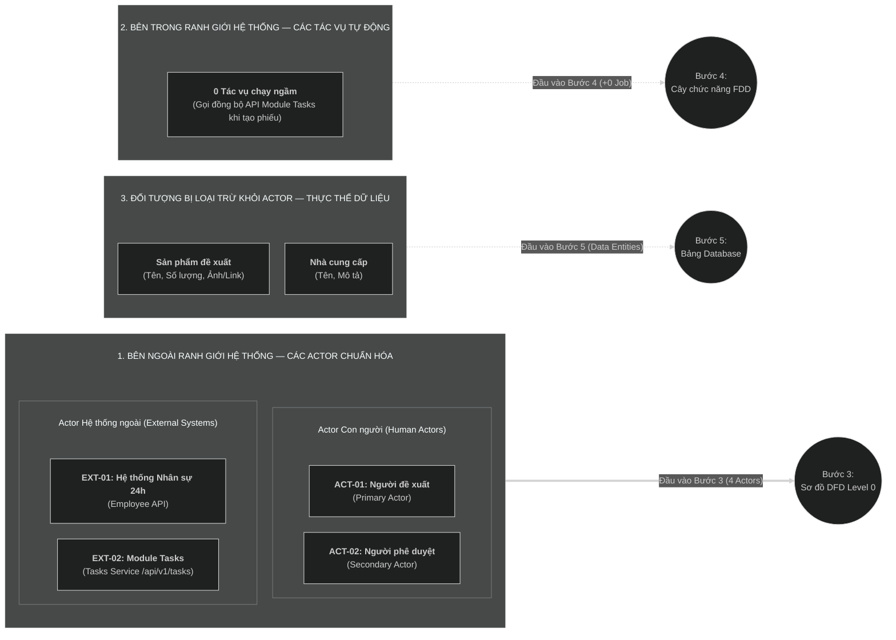

# BƯỚC 2: TRUY VẾT & BÓC TÁCH TÁC NHÂN (ACTOR IDENTIFICATION) — MODULE ĐỀ XUẤT MUA SẮM THIẾT BỊ

> **Tài liệu nguồn (Bước 1):** [`md/analysis/1-problem-survey.md`](./1-problem-survey.md)  
> **Quy chuẩn áp dụng:** [`.agents/rules/2-analysis/2_actor_identification_7_questions.md`](../../.agents/rules/2-analysis/2_actor_identification_7_questions.md)  
> **Đầu ra làm cơ sở cho:**
> - Bước 3 — Thiết kế Sơ đồ Ngữ cảnh DFD Level 0 (`md/analysis/3-dfd-context-diagram.md`)
> - Bước 4 — Sơ đồ Phân rã Chức năng FDD 3 Cấp & RBAC (`md/analysis/4-fdd-and-rbac.md`)
> - Bước 5 — Thiết kế Cơ sở Dữ liệu (`md/analysis/5-database-design.md`)

---

## 1. Kết quả Quét 7 Câu hỏi Truy vết Actor (Từ kết quả 5 Câu hỏi Khảo sát ở Bước 1)

| Thứ tự | Câu hỏi truy vết Actor | Tìm đối tượng nào? | Nguồn dữ liệu từ Bước 1 (`1-problem-survey.md`) | Kết quả phân tích & Đáp án đã chốt |
|:---:|---|---|---|---|
| **Câu 1** | **Ai trực tiếp đưa dữ liệu mới vào hệ thống?** | Primary Actor (Người nhập liệu, khởi phát quy trình) | Câu 2 (Quy trình hiện tại) & Câu 4 (Ai sử dụng) | **`ACT-01`: Người đề xuất (Nhân sự)** — Nhân viên nội bộ 24h Group đăng nhập hệ thống để trực tiếp tạo mới phiếu Đề xuất mua sắm dự trù (nhập danh sách sản phẩm kèm số lượng/hình ảnh/link, mục đích sử dụng, tổng giá trị dự kiến, nguồn kinh phí, danh sách nhà cung cấp, khoảng thời gian dự kiến giao hàng `từ ngày A -> đến ngày B`, chọn người duyệt) và chỉnh sửa phiếu của mình khi đang ở trạng thái `Chờ duyệt`. |
| **Câu 2** | **Ai tiếp nhận, duyệt hoặc xử lý bước tiếp theo?** | Secondary Actor (Người xử lý quy trình kế tiếp) | Câu 3 (Vấn đề quy trình) & Câu 4 (Ai sử dụng) | **`ACT-02`: Người phê duyệt** — Nhân viên nội bộ được Người đề xuất chọn làm người duyệt trên phiếu (`approver_id`); tiếp nhận phiếu ở trạng thái `Chờ duyệt`, xem chi tiết thông tin dự trù và ra quyết định chuyển trạng thái sang `Đã duyệt` hoặc `Từ chối` (đồng thời là người nhận việc trên Công việc được tạo tự động bên Module Tasks). |
| **Câu 3** | **Ai xem báo cáo, giám sát và ra quyết định?** | Supervisory Actor (Người quản lý, giám sát, đối soát) | Câu 4 (Ai sử dụng), Câu 5 & `QĐ-01` | **Không tách Supervisory Actor riêng trên Module Đề xuất mua sắm:** Quyền ra quyết định duyệt thuộc về **Người phê duyệt (`ACT-02`)**, còn toàn bộ luồng theo dõi/giám sát của các thành viên **nhóm Ban Giám Đốc (BGĐ)** diễn ra bên **Module Tasks sẵn có** (sau khi hệ thống gửi `_id` cố định của nhóm BGĐ lúc tạo Task). |
| **Câu 4** | **Khách hàng / Người dùng cuối tương tác trực tiếp hay gián tiếp?** | Self-service User vs Data Entity | Câu 2 (Kênh tiếp nhận) & Câu 4 (Ai sử dụng) | • Nhân sự nội bộ (`ACT-01: Người đề xuất`, `ACT-02: Người phê duyệt`) là **Self-service User** tự thao tác trực tiếp trên giao diện. • **Nhà cung cấp (`Supplier`)** và **Sản phẩm đề xuất (`Product Item`)** không đăng nhập hay tương tác trực tiếp mà do `ACT-01` nhập thông tin vào phiếu ➔ **Loại trừ khỏi Actor**, chuyển thành **Thực thể dữ liệu (`Data Entity`)** ở Bước 5. |
| **Câu 5** | **Hệ thống có trao đổi dữ liệu tự động với bên thứ 3 nào không?** | External System Actor (Hệ thống/Dịch vụ tích hợp API) | Câu 1 (Ranh giới hệ thống), Câu 5 & `QĐ-01`, `QĐ-03` | Có **2 Actor Hệ thống ngoài (`External Systems`)** trong hệ sinh thái 24h Group giao tiếp tự động qua API: 1. **`EXT-01`: Hệ thống Nhân sự 24h (Employee API)** — Cung cấp thông tin người đề xuất đang đăng nhập (Họ tên, chức vụ, bộ phận/phòng ban) và danh sách nhân viên để tìm kiếm/chọn Người phê duyệt. 2. **`EXT-02`: Module Tasks (`Tasks Service - /api/v1/tasks`)** — Nhận yêu cầu tự động tạo Công việc (gán Người phê duyệt làm người nhận việc, nhận `_id` cố định của nhóm BGĐ làm người theo dõi), tự bắn thông báo điều hướng nhảy vào công việc và trả về `task_id`. |
| **Câu 6** | **Có nghiệp vụ nào tự động chạy ngầm theo thời gian/hàng đợi không?** | Automated Process / Background Job (Cron job, Queue worker) | Câu 3 (Khâu thủ công cần tự động hóa) & Câu 5 | **Không có Cron Job hay Background Queue chạy ngầm riêng bên trong Module Đề xuất mua sắm (`0` tác vụ chạy ngầm):** Khi tạo phiếu đề xuất, hệ thống gọi API trực tiếp (đồng bộ) sang `EXT-02: Module Tasks` để tạo Công việc và nhận lại `task_id` ngay; mọi tiến trình gửi thông báo hay nhắc hạn công việc đều do Module Tasks sẵn có đảm nhiệm. |
| **Câu 7** | **Ai quản trị tài khoản, phân quyền và cấu hình nền tảng?** | System Admin (Quản trị viên hệ thống) | Câu 4 & Quyết định kiến trúc `QĐ-01`, `QĐ-03` | **Không sinh Actor Quản trị viên (`System Admin`) riêng trong phạm vi Module Đề xuất mua sắm:** Việc quản trị tài khoản nhân sự/phòng ban thuộc `EXT-01: Hệ thống Nhân sự 24h`, việc quản lý động thành viên nhóm BGĐ thuộc `EXT-02: Module Tasks`, và `_id` nhóm BGĐ được cố định (hardcode hằng số theo `QĐ-03`). Module phân quyền động theo từng phiếu đề xuất cho `ACT-01` và `ACT-02`. |

---

## 2. Áp dụng 4 Quy tắc Chuẩn hóa & Loại trừ Sai lầm

1. **Quy tắc 1 — Gộp chức danh trùng quyền:**
   - Mọi nhân viên ở các phòng ban/bộ phận khác nhau khi thực hiện lập phiếu dự trù mua sắm đều có cùng quyền hạn khởi tạo và chỉnh sửa phiếu ở trạng thái `Chờ duyệt` ➔ Gộp thành **`ACT-01: Người đề xuất`**.
   - Mọi nhân sự/cấp quản lý khi được chọn vào trường người duyệt của phiếu đều có cùng quyền xem và quyết định `Đã duyệt` / `Từ chối` ➔ Gộp thành **`ACT-02: Người phê duyệt`**.
2. **Quy tắc 2 — Phân biệt Actor vs Data Entity:**
   - **Sản phẩm đề xuất** (Tên, số lượng, hình ảnh/link) và **Nhà cung cấp** (Tên, mô tả) không tự thao tác trực tiếp trên phần mềm mà do `ACT-01` nhập vào lưu trữ ➔ Loại khỏi danh sách Actor, đưa vào **Bảng 3 (Thực thể dữ liệu — `Entity`)** để thiết kế cấu trúc bảng Database ở Bước 5.
3. **Quy tắc 3 — Loại bỏ Hệ thống ngoài giả định:**
   - Việc liên hệ hỏi báo giá nhà cung cấp diễn ra bên ngoài rồi con người nhập thông tin vào phiếu nên không có hệ thống nhà cung cấp bên ngoài. Chỉ giữ lại 2 hệ thống thực sự trao đổi dữ liệu qua API là **`EXT-01: Hệ thống Nhân sự 24h`** và **`EXT-02: Module Tasks`**.
4. **Quy tắc 4 — Tác vụ tự động (Cron Job / Queue) KHÔNG phải là Actor:**
   - Bên trong ranh giới Module Đề xuất mua sắm có **`0` tác vụ chạy ngầm** (vì việc gọi sang `EXT-02: Module Tasks` tạo công việc diễn ra đồng bộ lúc tạo phiếu, còn tiến trình thông báo/nhắc việc chạy bên trong `EXT-02`).

---

## 3. Các Bảng Tổng hợp Truy vết (Đầu vào cho Bước 3, Bước 4, Bước 5)

### 3.1. Bảng 1: Danh sách Actor Chuẩn hóa (Bên ngoài Ranh giới Hệ thống ➔ Đầu vào Bước 3: DFD Level 0)

| Mã Actor | Tên Actor chuẩn hóa | Nhóm Actor | Phân loại Vai trò | Nguồn truy vết | Trách nhiệm & Luồng tương tác chính với Module Đề xuất mua sắm |
|:---:|---|---|---|---|---|
| **`ACT-01`** | **Người đề xuất** *(Proposer)* | Actor Con người *(Human Actor)* | Primary Actor | Câu 1, Câu 4 | Khởi tạo phiếu Đề xuất mua sắm dự trù (hệ thống tự điền thông tin cá nhân, nhập sản phẩm, nhà cung cấp, mục đích, tổng tiền, nguồn kinh phí, thời gian giao hàng `A -> B`, chọn người duyệt); tải ảnh/link sản phẩm; chỉnh sửa phiếu khi đang ở trạng thái `Chờ duyệt`; tra cứu danh sách và xem chi tiết trạng thái phiếu đề xuất. |
| **`ACT-02`** | **Người phê duyệt** *(Approver)* | Actor Con người *(Human Actor)* | Secondary Actor | Câu 2, Câu 3, Câu 4 | Nhân sự được chọn duyệt đề xuất (`approver_id`); tra cứu danh sách và xem chi tiết phiếu đề xuất mua sắm được giao duyệt; thực hiện phê duyệt chuyển trạng thái phiếu từ `Chờ duyệt` sang `Đã duyệt` hoặc `Từ chối`. |
| **`EXT-01`** | **Hệ thống Nhân sự 24h** *(24h Employee API)* | Actor Hệ thống ngoài *(External System)* | External Data Provider | Câu 5, Câu 7 | Cung cấp API trả về thông tin người đề xuất đang đăng nhập (Họ và tên, chức vụ, bộ phận/phòng ban) để tự động điền vào form, và API tìm kiếm danh sách nhân viên nội bộ để chọn Người phê duyệt. |
| **`EXT-02`** | **Module Tasks** *(Tasks Service `/api/v1/tasks`)* | Actor Hệ thống ngoài *(External System)* | External Integration Service | Câu 3, Câu 5, Câu 7 | Tiếp nhận request API tạo Công việc tự động ngay khi phiếu Đề xuất mua sắm được tạo (nhận thông tin công việc, `approver_id` làm người nhận việc `assignees`, `_id` cố định của nhóm **BGĐ** làm người theo dõi); tự động bắn thông báo trên App/Web để ấn vào nhảy thẳng tới công việc và trả về `task_id` liên kết. |

---

### 3.2. Bảng 2: Danh sách Tác vụ Tự động Chạy ngầm (Bên trong Ranh giới Hệ thống ➔ Đầu vào Bước 4: FDD)

| Mã Tác vụ | Tên Tác vụ tự động (Cron Job / Background Queue) | Chu kỳ / Sự kiện kích hoạt | Nguồn truy vết | Ghi chú ánh xạ sang Bước 4 (FDD) |
|:---:|---|---|---|---|
| *(Không có)* | **0 Tác vụ tự động chạy ngầm** | — | Câu 6 | Luồng tạo Công việc sang `EXT-02 (Module Tasks)` được gọi đồng bộ khi tạo phiếu đề xuất; số lượng Tác vụ tự động cộng thêm vào công thức FDD Cấp 2 ở Bước 4 bằng **`0`**. |

---

### 3.3. Bảng 3: Đối tượng bị Loại trừ khỏi Actor ➔ Chuyển thành Thực thể Dữ liệu (Đầu vào Bước 5: Database)

| STT | Tên đối tượng bị loại trừ | Nguồn xuất hiện trong đề bài | Lý do loại trừ khỏi Actor | Hướng ánh xạ sang Bước 5 (Thiết kế Database) |
|:---:|---|---|---|---|
| **1** | **Sản phẩm đề xuất** *(Requested Product Item)* | *"Nội dung đề xuất mua sắm: có thể có nhiều sản phẩm, mỗi sản phẩm có Tên, Số lượng, Hình ảnh hoặc link đính kèm"* | Không tự thao tác trên hệ thống; chỉ là dữ liệu danh sách mặt hàng dự trù do `ACT-01 (Người đề xuất)` nhập vào phiếu. | Ánh xạ thành mảng subdocument `products[]` nhúng trong bảng **`PurchaseRequisition`**. |
| **2** | **Nhà cung cấp** *(Supplier)* | *"Danh sách nhà cung cấp: Có thể có nhiều nhà cung cấp (Tên, mô tả)"* | Đối tác không đăng nhập hệ thống; chỉ là thông tin tham khảo (`Tên, mô tả`) do `ACT-01 (Người đề xuất)` nhập vào phiếu dự trù. | Ánh xạ thành mảng subdocument `suppliers[]` nhúng trong bảng **`PurchaseRequisition`**. |

---

## 4. Sơ đồ Phân loại Actor & Ranh giới Hệ thống (Traceability Diagram)

