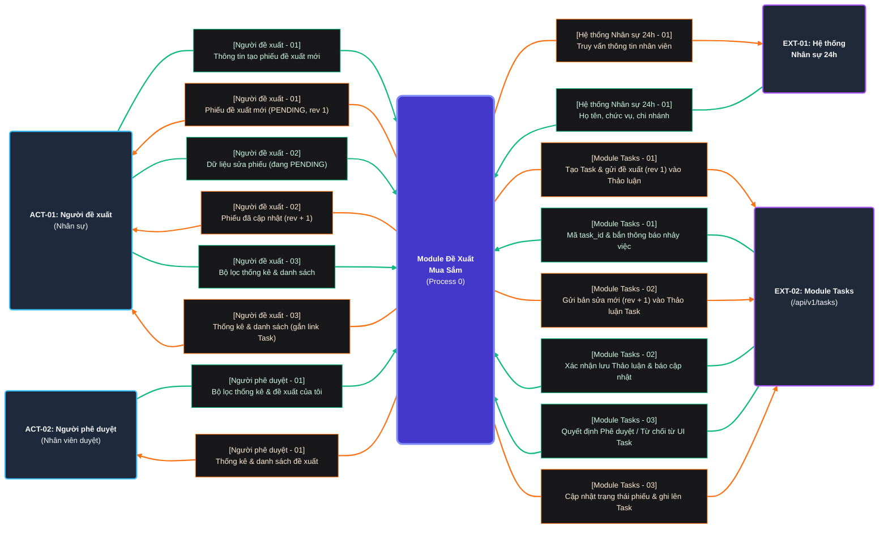

# BƯỚC 3: THIẾT KẾ SƠ ĐỒ NGỮ CẢNH (DFD LEVEL 0) — MODULE ĐỀ XUẤT MUA SẮM THIẾT BỊ

> **Tài liệu nguồn (Bước 2):** [`md/analysis/2-actor-identification.md`](./2-actor-identification.md)  
> **Quy chuẩn áp dụng:** [`.agents/rules/2-analysis/3_dfd_level_0_standard.md`](../../.agents/rules/2-analysis/3_dfd_level_0_standard.md)  
> **Đầu ra làm cơ sở cho:**
> - Bước 4 — Sơ đồ Phân rã Chức năng FDD 3 Cấp & Ma trận RBAC (`md/analysis/4-fdd-and-rbac.md`)
> - Bước 5 — Thiết kế Cơ sở Dữ liệu (`md/analysis/db/5-database-design.md`)

---

## 1. Nguyên tắc Hộp đen, Bố cục Sơ đồ & Quy ước Kiến trúc Đã Chốt

1. **Nguyên lý Hộp đen (`Process 0`):**
   - Toàn bộ **Module Đề xuất mua sắm** được biểu diễn bằng 1 khối trung tâm duy nhất **`Module Đề Xuất Mua Sắm (Process 0)`** ở cột giữa (dạng hình chữ nhật đứng cao để tách thoáng từng cặp mũi tên).
   - Bố cục 3 cột cân đối (`4` cặp luồng bên trái — `4` cặp luồng bên phải):
     - **Cột Trái:** `ACT-01: Người đề xuất` (`3` cặp hành động) và `ACT-02: Người phê duyệt` (`1` cặp hành động trực tiếp trên Module Đề xuất).
     - **Cột Giữa:** `Module Đề Xuất Mua Sắm (Process 0)`.
     - **Cột Phải:** `EXT-01: Hệ thống Nhân sự 24h` (`1` cặp tương tác) và `EXT-02: Module Tasks` (`3` cặp tương tác).
2. **Quy tắc Hiển thị Cặp Luồng Dữ liệu theo Tác vụ:**
   - Mỗi mã hành động `[Tên vai trò - STT]` được biểu diễn thành **1 cặp mũi tên xếp liền nhau** (luồng khởi phát ở trên — luồng phản hồi ở dưới).
   - **Màu xanh lá (`#10b981`):** Luồng dữ liệu đi **VÀO** Hệ thống (`Process 0`).
   - **Màu cam (`#f97316`):** Luồng dữ liệu đi **RA** khỏi Hệ thống (`Process 0`).
3. **Điểm cốt lõi về Luồng Tương tác với `EXT-02: Module Tasks` & `ACT-02: Người phê duyệt`:**
   - **Khi Tạo phiếu (`revision = 1`) & Sửa phiếu (`revision + 1`):** Hệ thống kích hoạt **Hook đồng bộ** gọi sang `EXT-02: Module Tasks` để tạo Task (gán `ACT-02` nhận việc, nhóm `BGĐ` theo dõi) và **đẩy trực tiếp nội dung phiếu đề xuất / bản cập nhật mới vào tab `Trao đổi & Thảo luận` của Task** (`POST /api/v1/tasks/comments`).
   - **Khi Xem chi tiết, Thảo luận & Phê duyệt:** `ACT-02` **không đi vào Module Đề xuất mua sắm** để xem chi tiết hay duyệt, mà mở Task trong *"Công việc của tôi"* bên **Module Tasks**, đọc nội dung đề xuất trong phần **Trao đổi & Thảo luận**, trao đổi và bấm **`Phê duyệt` / `Từ chối`** ngay trên giao diện Module Tasks (`[Module Tasks - 03]`).
   - **Khi `ACT-02` vào Module Đề xuất mua sắm:** Chỉ khi `ACT-02` muốn **Xem thống kê & danh sách các đề xuất** liên quan đến mình (`[Người phê duyệt - 01]`).

---

## 2. Sơ đồ Ngữ cảnh DFD Level 0

---

## 3. Bảng Đặc tả Actor - Hành động 5 Cột

| Actor | Mã | Hành động | Dữ liệu Input (Gửi vào `Process 0`) | Dữ liệu Output (Nhận ra từ `Process 0`) |
|---|:---:|---|---|---|
| **`ACT-01` Người đề xuất** | `[Người đề xuất - 01]` | **Tạo mới phiếu đề xuất mua sắm** *(hồ sơ cá nhân tự trích xuất từ `req.auth`)* | • Chi nhánh mua (`employee_branch`), chức vụ (`employee_position` mặc định từ `req.auth.group_user_name`). • Danh sách thiết bị `items` (`name`, `quantity`, `attachments`). • Mục đích (`purpose`), Tổng chi phí dự kiến (`estimated_total`), Nguồn kinh phí (`funding_source`). • Danh sách nhà cung cấp `suppliers` (`name`, `description`). • Ngày giao dự kiến (`delivery_from`, `delivery_to`), Hạn chót duyệt (`task_deadline`), Người duyệt (`employee_approver_id`). | • Phiếu đề xuất mua sắm vừa tạo (`status = PENDING`, `revision = 1`, đã gắn `task_id` từ Hook tạo Task). |
| **`ACT-01` Người đề xuất** | `[Người đề xuất - 02]` | **Cập nhật phiếu đề xuất mua sắm (khi đang `PENDING`)** | • Mã phiếu đề xuất (`:id`) và các trường thông tin đề xuất cần chỉnh sửa. | • Phiếu đề xuất mua sắm đã cập nhật (`revision` tăng `+1`) và tự động đồng bộ bản sửa sang Thảo luận Task qua Hook. |
| **`ACT-01` Người đề xuất** | `[Người đề xuất - 03]` | **Xem thống kê & danh sách phiếu đề xuất** | • Bộ lọc thống kê và danh sách (`page`, `limit`, `status`, `employee_branch`, khoảng ngày, phạm vi phiếu của tôi). | • Số liệu thống kê tổng hợp (tổng phiếu, chờ duyệt, đã duyệt, từ chối, tổng tiền dự kiến) và danh sách phiếu gắn link nhảy sang Task (`/tasks?task_id=<task_id>`). |
| **`ACT-02` Người phê duyệt** | `[Người phê duyệt - 01]` | **Xem thống kê & danh sách phiếu đề xuất của tôi** *(Trùng hành động tra cứu thống kê/danh sách với `[Người đề xuất - 03]`)* | • Bộ lọc thống kê và danh sách các đề xuất mình được giao duyệt (`employee_approver_id`) hoặc theo dõi. | • Số liệu thống kê và danh sách phiếu đề xuất liên quan (gắn link nhảy sang Task bên Module Tasks). |
| **`EXT-01` Hệ thống Nhân sự 24h** | `[Hệ thống Nhân sự 24h - 01]` | **Xác thực & cung cấp thông tin nhân viên theo ID** | • *(Hệ thống nhận về)* Thông tin chi tiết nhân sự đang làm việc (Họ tên, SĐT, chức vụ, chi nhánh). | • *(Hệ thống gửi sang)* Yêu cầu kiểm tra `employee_approver_id` hoặc lấy thông tin nhiều nhân sự theo mảng `[employee_id, employee_approver_id]`. |
| **`EXT-02` Module Tasks** | `[Module Tasks - 01]` | **Khởi tạo Task duyệt đề xuất & nhận nội dung phiếu lần đầu (`revision = 1`) vào Thảo luận** *(Gọi từ `HOOK-01`)* | • *(Hệ thống nhận về)* Mã công việc (`task_id`), xác nhận lưu bình luận đề xuất lần 1 và bắn thông báo nhảy việc trên App/Web. | • *(Hook gửi sang)* Yêu cầu tạo Task (`POST /api/v1/tasks/tasks`: `ACT-02` nhận việc, nhóm `BGĐ` theo dõi, `deadline = task_deadline`) + gửi nội dung phiếu (`revision = 1`) vào tab **Trao đổi & Thảo luận** (`POST /api/v1/tasks/comments`). |
| **`EXT-02` Module Tasks** | `[Module Tasks - 02]` | **Nhận nội dung bản cập nhật phiếu (`revision + 1`) vào Thảo luận Task** *(Gọi từ `HOOK-02`)* | • *(Hệ thống nhận về)* Xác nhận đã thêm bình luận bản sửa mới vào luồng Thảo luận và bắn thông báo cập nhật trên Task. | • *(Hook gửi sang)* Nội dung phiếu đề xuất mới cập nhật (`revision = 2, 3...`) gửi vào tab **Trao đổi & Thảo luận** của `task_id` (`POST /api/v1/tasks/comments`). |
| **`EXT-02` Module Tasks** | `[Module Tasks - 03]` | **Gửi quyết định Phê duyệt / Từ chối của `ACT-02` từ giao diện Task** | • Quyết định **`APPROVED`** hoặc **`REJECTED`** (kèm `reject_reason`) do `ACT-02` thao tác ngay trên giao diện Chi tiết Task bên Module Tasks. | • Bản ghi `PurchaseRequest` đã khóa ở trạng thái `APPROVED` / `REJECTED` (`decided_at = Date.now`) và ghi kết quả duyệt vào Thảo luận Task để báo cho `ACT-01`. |

---

## 4. Tóm tắt Số liệu Đầu vào cho Bước 4 (Sơ đồ Phân rã Chức năng FDD 3 Cấp)

- **Tổng số cặp tương tác trên DFD Level 0:** `8` cặp (`4` cặp Cột Trái + `4` cặp Cột Phải):
  - `ACT-01 (Người đề xuất)`: `3` hành động trực tiếp trên Module Đề xuất (`[Người đề xuất - 01..03]`).
  - `ACT-02 (Người phê duyệt)`: `1` hành động trực tiếp trên Module Đề xuất (`[Người phê duyệt - 01]` — trùng hành động xem thống kê/danh sách với `[Người đề xuất - 03]`) + `1` hành động ra quyết định phê duyệt/từ chối thực hiện từ giao diện **Module Tasks** (`[Module Tasks - 03]`).
  - `EXT-01 (Hệ thống Nhân sự 24h)`: `1` tương tác tra cứu thông tin nhân sự theo ID.
  - `EXT-02 (Module Tasks)`: `3` tương tác (`2` chiều đi từ Hook `HOOK-01`, `HOOK-02` đẩy sang Thảo luận Task + `1` chiều quyết định duyệt từ UI Task gửi về).
- **Công thức Bảo toàn Chức năng Cấp 2 sang Bước 4:**
  - Chức năng do Người dùng kích hoạt trực tiếp: `(3 + 1 - 1) + 1 = 4` chức năng (`Tạo phiếu đề xuất`, `Cập nhật phiếu đề xuất`, `Xem thống kê & danh sách đề xuất`, `Quyết định phê duyệt/từ chối đề xuất từ Task`).
  - Hook tự động nội bộ từ Bước 2 (`Bảng 2`): `+2` chức năng (`HOOK-01: Khởi tạo Task & đẩy đề xuất lần 1 vào Thảo luận`, `HOOK-02: Đồng bộ bản cập nhật đề xuất vào Thảo luận Task`).
  - **Tổng cộng = `4 + 2 = 6` Chức năng Cấp 2** (tách bạch rõ giữa nhóm chức năng trên Module Đề xuất và nhóm chức năng tích hợp Module Tasks).
