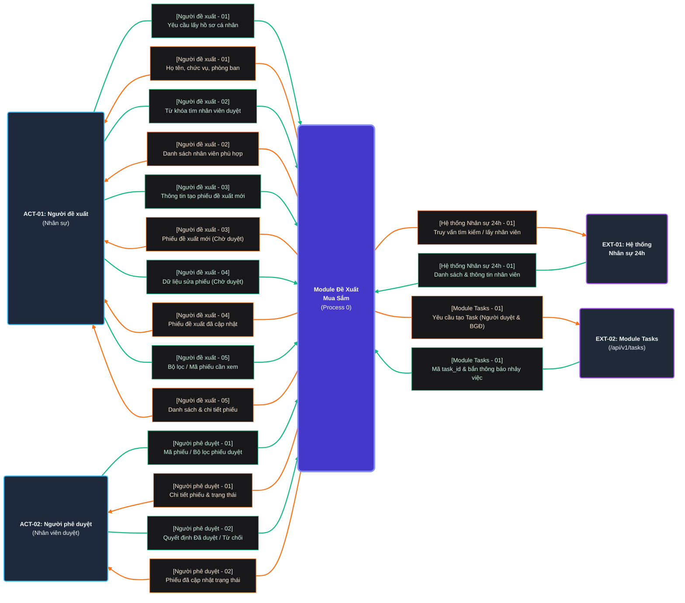

# BƯỚC 3: THIẾT KẾ SƠ ĐỒ NGỮ CẢNH (DFD LEVEL 0) — MODULE ĐỀ XUẤT MUA SẮM THIẾT BỊ

> **Tài liệu nguồn (Bước 2):** [`md/analysis/2-actor-identification.md`](./2-actor-identification.md)  
> **Quy chuẩn áp dụng:** [`.agents/rules/2-analysis/3_dfd_level_0_standard.md`](../../.agents/rules/2-analysis/3_dfd_level_0_standard.md)  
> **Đầu ra làm cơ sở cho:**
> - Bước 4 — Sơ đồ Phân rã Chức năng FDD 3 Cấp & Ma trận RBAC (`md/analysis/4-fdd-and-rbac.md`)
> - Bước 5 — Thiết kế Cơ sở Dữ liệu (`md/analysis/5-database-design.md`)

---

## 1. Nguyên tắc Hộp đen, Bố cục Sơ đồ & Quy ước Kiến trúc

1. **Nguyên lý Hộp đen (`Process 0`):**
   - Toàn bộ tính năng mở rộng **Module Đề xuất mua sắm** được biểu diễn bằng 1 khối trung tâm duy nhất **`Module Đề Xuất Mua Sắm (Process 0)`** ở cột giữa (dạng hình chữ nhật đứng cao để phân bổ thoáng các đầu/đuôi mũi tên). Tuyệt đối không vẽ bảng Database hay phân hệ con bên trong sơ đồ DFD Level 0.
   - Bố cục 3 cột chuẩn: **Cột Trái** đặt 2 Actor Con người (`ACT-01: Người đề xuất`, `ACT-02: Người phê duyệt`); **Cột Giữa** đặt `Process 0`; **Cột Phải** đặt 2 Actor Hệ thống ngoài (`EXT-01: Hệ thống Nhân sự 24h`, `EXT-02: Module Tasks`).
2. **Quy tắc Hiển thị Cặp Luồng Dữ liệu theo Tác vụ:**
   - Không gộp chung nhiều luồng dữ liệu vào 1 mũi tên; mỗi mã hành động `[Tên vai trò - STT]` được biểu diễn thành **1 cặp mũi tên xếp liền nhau** (luồng đi ở trên — luồng trả về ở dưới).
   - **Màu xanh lá (`#10b981`):** Luồng dữ liệu đi **VÀO** Hệ thống (`Process 0`).
   - **Màu cam (`#f97316`):** Luồng dữ liệu đi **RA** khỏi Hệ thống (`Process 0`).
3. **Ghi chú Kiến trúc Tích hợp với Module Tasks (Đã chốt):**
   - Không thêm cột `type` dư thừa vào collection `tasks`.
   - Khi tạo mới Phiếu đề xuất mua sắm, hệ thống lưu bản ghi Đề xuất mua sắm và tự động tạo Công việc (`Task`) có trường liên kết với Phiếu đề xuất. Trên giao diện chi tiết Công việc, hệ thống kiểm tra nếu có liên kết với Phiếu đề xuất thì hiển thị thông tin Phiếu đề xuất và cụm nút quyết định **`Phê duyệt` / `Từ chối`**.

---

## 2. Sơ đồ Ngữ cảnh DFD Level 0

---

## 3. Bảng Đặc tả Actor - Hành động 5 Cột

| Actor | Mã | Hành động | Dữ liệu Input (Actor gửi vào) | Dữ liệu Output (Actor nhận lại) |
|---|:---:|---|---|---|
| **`ACT-01` Người đề xuất** | `[Người đề xuất - 01]` | **Lấy thông tin cá nhân người đề xuất (tự động điền khi mở form)** | • Phiên đăng nhập hiện tại của nhân sự (`req.auth` từ `token`). | • Thông tin người đề xuất tự động điền trực tiếp từ `req.auth` (không gọi `EXT-01`): Họ tên, chức vụ (`group_user_name`), bộ phận/chi nhánh (`branch_name`), ngày đề xuất (= ngày tạo). |
| **`ACT-01` Người đề xuất** | `[Người đề xuất - 02]` | **Tìm kiếm nhân viên để chọn người duyệt đề xuất** | • Từ khóa tìm kiếm nhân viên (`keyword`: tên hoặc số điện thoại). | • Danh sách nhân viên phù hợp (Họ tên, chức vụ, bộ phận/phòng ban) để chọn làm Người duyệt. |
| **`ACT-01` Người đề xuất** | `[Người đề xuất - 03]` | **Tạo mới phiếu đề xuất mua sắm** | • Thông tin người đề xuất. • Nội dung mua sắm: Danh sách sản phẩm (Tên, Số lượng, Hình ảnh hoặc link đính kèm). • Mục đích sử dụng, Tổng giá trị dự kiến, Nguồn kinh phí. • Danh sách nhà cung cấp (Tên, mô tả). • Thời gian dự kiến giao hàng (`từ ngày A -> đến ngày B`). • Nhân viên được chọn duyệt đề xuất (`approver_id`). | • Phiếu đề xuất mua sắm vừa được tạo thành công với trạng thái **`Chờ duyệt`**. |
| **`ACT-01` Người đề xuất** | `[Người đề xuất - 04]` | **Cập nhật phiếu đề xuất mua sắm (khi đang `Chờ duyệt`)** | • Mã phiếu đề xuất (`:id`) và các thông tin đề xuất cần chỉnh sửa. | • Phiếu đề xuất mua sắm sau khi cập nhật thành công. |
| **`ACT-01` Người đề xuất** | `[Người đề xuất - 05]` | **Xem danh sách và chi tiết phiếu đề xuất mua sắm** | • Mã phiếu đề xuất hoặc tiêu chí lọc danh sách (`page`, `limit`, `keyword`, `status`, `from_date`, `to_date`). | • Danh sách phiếu đề xuất (gắn link nhảy tới Task) và chi tiết nội dung phiếu hiển thị trong UI Tasks kèm trạng thái (`Chờ duyệt`, `Đã duyệt`, `Từ chối`). |
| **`ACT-02` Người phê duyệt** | `[Người phê duyệt - 01]` | **Xem danh sách và chi tiết phiếu đề xuất mua sắm** *(Trùng hành động xem với `[Người đề xuất - 05]`)* | • Mã phiếu đề xuất (liên kết trên Task) hoặc tiêu chí lọc danh sách phiếu được giao duyệt. | • Chi tiết nội dung phiếu đề xuất mua sắm cần duyệt và trạng thái hiện tại trong UI Tasks. |
| **`ACT-02` Người phê duyệt** | `[Người phê duyệt - 02]` | **Phê duyệt hoặc Từ chối phiếu đề xuất mua sắm** | • Mã phiếu đề xuất (`:id`) và quyết định chọn **`Đã duyệt`** hoặc **`Từ chối`** (kèm lý do/ghi chú nếu có). | • Phiếu đề xuất mua sắm đã chuyển trạng thái sang **`Đã duyệt`** hoặc **`Từ chối`**. |
| **`EXT-01` Hệ thống Nhân sự 24h** | `[Hệ thống Nhân sự 24h - 01]` | **Cung cấp danh sách & thông tin nhân viên theo từ khóa/ID** | • *(Hệ thống gửi sang)* Từ khóa tìm kiếm nhân viên (`search`, phân trang) hoặc danh sách `ids` nhân sự cần tra cứu. | • *(Gửi vào Hệ thống)* Danh sách nhân viên đang làm việc kèm họ tên, SĐT, chức vụ, bộ phận/chi nhánh. |
| **`EXT-02` Module Tasks** | `[Module Tasks - 01]` | **Tạo Công việc liên kết với Phiếu đề xuất, gắn nhóm BGĐ theo dõi & bắn thông báo** | • *(Hệ thống tự động gọi sang khi lưu phiếu mới)* Dữ liệu tạo Công việc gắn mã phiếu đề xuất, Người giao việc = Người đề xuất, Người nhận việc = Người được chọn duyệt, Người theo dõi = thành viên nhóm **BGĐ** (`BGD_GROUP_ID`). | • *(Gửi vào Hệ thống)* Mã công việc (`task_id`) đã tạo và kích hoạt bắn thông báo trên App/Web để ấn vào nhảy đúng công việc đó. |

---

## 4. Tóm tắt Số liệu Đầu vào cho Bước 4 (Sơ đồ Phân rã Chức năng FDD 3 Cấp)

- **Tổng số mã tương tác trên DFD Level 0:** `9` mã hành động:
  - `ACT-01 (Người đề xuất)`: `5` hành động (`[Người đề xuất - 01..05]`, trong đó `[Người đề xuất - 01]` đọc trực tiếp từ `req.auth`).
  - `ACT-02 (Người phê duyệt)`: `2` hành động (`[Người phê duyệt - 01..02]`).
  - `EXT-01 (Hệ thống Nhân sự 24h)`: `1` tương tác cung cấp dữ liệu nhân viên phục vụ cho `[Người đề xuất - 02]` và hiển thị thông tin nhân sự.
  - `EXT-02 (Module Tasks)`: `1` tương tác tích hợp tạo Công việc & thông báo phục vụ ngầm khi thực thi `[Người đề xuất - 03]`.
- **Hành động trùng giữa các Actor con người:** `[Người đề xuất - 05]` và `[Người phê duyệt - 01]` cùng là chức năng **Xem danh sách và chi tiết phiếu đề xuất mua sắm** (được hợp nhất thành 1 chức năng `FDD-05` trên FDD theo nguyên tắc MECE).
