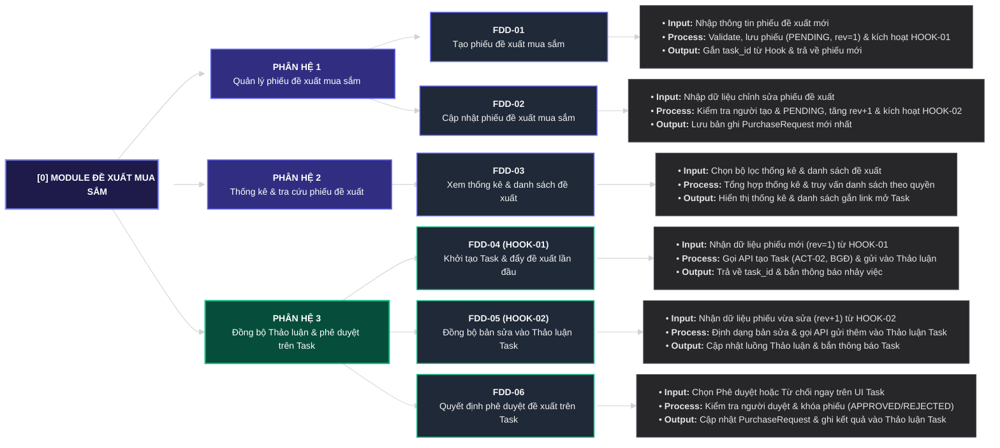

# BƯỚC 4: SƠ ĐỒ PHÂN RÃ CHỨC NĂNG (FDD 3 CẤP) & MA TRẬN RBAC — MODULE ĐỀ XUẤT MUA SẮM THIẾT BỊ

> **Tài liệu nguồn:** [`md/analysis/1-problem-survey.md`](./1-problem-survey.md), [`md/analysis/2-actor-identification.md`](./2-actor-identification.md), [`md/analysis/3-dfd-context-diagram.md`](./3-dfd-context-diagram.md)  
> **Quy chuẩn áp dụng:** [`.agents/rules/2-analysis/4_fdd_and_rbac_standard.md`](../../.agents/rules/2-analysis/4_fdd_and_rbac_standard.md)  
> **Đầu ra làm cơ sở cho:**
> - Bước 5 — Thiết kế Cơ sở Dữ liệu & Bảng Đặc tả 4 Cột (`md/analysis/db/5-database-design.md`)
> - Bước 6 — Thiết kế Tài liệu RESTful API (`md/analysis/6-api-specification.md`)

---

## 1. Đối chiếu Mã nguồn Hệ thống Hiện hữu (`suachualaptop24h` & `24hgroup_noibo`) — Các Cơ chế & API Tích hợp Thực tế

| Hạng mục tích hợp | Cơ chế / Endpoint thực tế sử dụng | Tham chiếu mã nguồn hệ thống | Dữ liệu Input / Output thực tế |
|---|---|---|---|
| **1. Hồ sơ người đề xuất & Phụ trợ nhập liệu Form (`FDD-01`, `FDD-02`)** | • **Hồ sơ người tạo:** Đọc trực tiếp từ **`req.auth`** (middleware `requireAuthAPI`) hoặc **`res.locals.auth`**. • **Chọn người duyệt & Upload ảnh trên Form:** Gọi trực tiếp API sẵn có `GET /api/v1/auth/search` (hoặc `GET /api/v1/tasks/employees/search`) và `POST /api/v1/upload/single?folder=purchase_requisition`. | • `24hgroup_noibo/src/middlewares/auth_middleware.js` • `24hgroup_noibo/src/routes/api/v1/auth.js` • `24hgroup_noibo/src/routes/api/v1/upload.js` • `24hgroup_noibo/services/tasks/src/controllers/employee_controller.js` | • `req.auth`: `_id`, `fullname`, `phone`, `group_user_name` (Chức vụ), `branch_name` (Chi nhánh), `image`. • Upload trả về `{ success: true, url, file_url, file_name, file_type }`. |
| **2. Tra cứu thông tin nhân sự theo mảng ID (`FDD-03`, `FDD-04`, `FDD-05`)** | `POST /api/v1/auth/get-detail-multiple` ➔ gọi sang `POST ${GATEWAY_API_URL_AUTH}/api/employee/employee/detail-multiple` (`{ ids: JSON.stringify([...]) }`) hoặc truy vấn `ModelEmployee` nội bộ. | • `24hgroup_noibo/src/routes/api/v1/auth.js` • `suachualaptop24h/routers/ver3/api_employee.js` • `suachualaptop24h/models/Employee.js` | Mảng nhân viên tương ứng `[employee_id, employee_approver_id]` (Họ tên, chức vụ, chi nhánh) để hiển thị trên danh sách và định dạng nội dung thảo luận. |
| **3. Hook khởi tạo Task & đẩy đề xuất lần đầu vào Thảo luận (`FDD-04` — `HOOK-01`)** | 1. Lấy thành viên nhóm BGĐ theo `BGD_GROUP_ID`: **`GET /api/v1/tasks/groups/:groupId/members`**. 2. Tạo Công việc: **`POST /api/v1/tasks/tasks`** (`assignees: [employee_approver_id]`, `watchers: [...bgd_member_ids]`, `deadline: task_deadline`). 3. Đẩy nội dung phiếu (`revision = 1`) vào tab **Trao đổi & Thảo luận**: **`POST /api/v1/tasks/comments`** (`{ task_id, content, attachments }`). | • `24hgroup_noibo/services/tasks/src/controllers/group_controller.js` • `24hgroup_noibo/services/tasks/src/controllers/task_controller.js` • `24hgroup_noibo/services/tasks/src/controllers/comment_controller.js` | Trả về `task_id` lưu vào `PurchaseRequest.task_id`, lưu bình luận nội dung đề xuất lần 1 và bắn thông báo nhảy thẳng vào `/tasks?task_id=<task_id>`. |
| **4. Hook đồng bộ bản sửa đề xuất vào Thảo luận Task (`FDD-05` — `HOOK-02`)** | Khi phiếu ở trạng thái `PENDING` được cập nhật (`revision + 1`), gọi **`POST /api/v1/tasks/comments`** theo `task_id` để thêm bình luận nội dung bản sửa mới vào tab **Trao đổi & Thảo luận** (và `PUT /api/v1/tasks/tasks/:id` nếu thay đổi `task_deadline` / `employee_approver_id`). | • `24hgroup_noibo/services/tasks/src/controllers/comment_controller.js` • `24hgroup_noibo/services/tasks/src/controllers/task_controller.js` | Lưu lịch sử các phiên bản đề xuất (`revision 1, 2...`) xuyên suốt luồng thảo luận của Task và bắn thông báo cập nhật. |
| **5. Phê duyệt / Từ chối đề xuất từ giao diện Module Tasks (`FDD-06`)** | Người phê duyệt (`ACT-02`) mở Task trong *"Công việc của tôi"*, xem nội dung trong tab **Trao đổi & Thảo luận** và bấm **`Phê duyệt` / `Từ chối`** ngay trên giao diện Task ➔ cập nhật `PurchaseRequest` (`APPROVED` / `REJECTED`) và ghi bình luận/lịch sử kết quả duyệt lên Task để báo cho `ACT-01` bấm **`Hoàn thành công việc tổng`**. | • `24hgroup_noibo/services/tasks/src/controllers/comment_controller.js` • `24hgroup_noibo/services/tasks/src/controllers/activity_controller.js` • `24hgroup_noibo/services/tasks/src/services/notification_client.js` | Khóa phiếu đề xuất vĩnh viễn ở trạng thái `APPROVED` / `REJECTED` (`decided_at`, `reject_reason`) và đồng bộ thông báo trên Module Tasks. |

---

## 2. Nguyên tắc Phân rã MECE & Kiểm chứng Công thức Bảo toàn Chức năng Cấp 2

1. **Nguyên tắc MECE & Cú pháp `Động từ + Danh từ`:**
   - Chia nhánh Cấp 1 theo **Miền nghiệp vụ & Ranh giới tích hợp cốt lõi** (không chia theo tên Actor):
     - **Phân hệ 1:** `Quản lý phiếu đề xuất mua sắm` *(Khởi tạo và chỉnh sửa chứng từ trên Module Đề xuất)*
     - **Phân hệ 2:** `Thống kê & tra cứu phiếu đề xuất` *(Tổng hợp số liệu và tra cứu danh sách trên Module Đề xuất)*
     - **Phân hệ 3:** `Đồng bộ Thảo luận & phê duyệt trên Task` *(Cơ chế Hook đồng bộ sang Thảo luận Task và luồng quyết định duyệt từ giao diện Module Tasks)*
   - 100% các nút ở Cấp 1, Cấp 2 và Cấp 3 đều bắt đầu bằng **`Động từ + Danh từ`**.
2. **Kiểm chứng Công thức Bảo toàn Số lượng Chức năng Cấp 2:**
   - **Hành động người dùng kích hoạt trực tiếp ở Bước 3:** `5` hành động (`3` của `ACT-01` trên Module Đề xuất + `1` của `ACT-02` xem thống kê/danh sách trên Module Đề xuất + `1` hành động quyết định duyệt của `ACT-02` gửi từ giao diện Module Tasks `[Module Tasks - 03]`).
   - **Số Hành động trùng giữa các Actor:** `1` hành động (`[Người đề xuất - 03]` và `[Người phê duyệt - 01]` cùng là *Xem thống kê & danh sách phiếu đề xuất* ➔ hợp nhất thành `FDD-03`).
   - **Số Hook tự động nội bộ ở Bước 2 (`Bảng 2`):** `2` Hook (`HOOK-01: onPurchaseRequestCreated` ➔ `FDD-04` và `HOOK-02: onPurchaseRequestUpdated` ➔ `FDD-05`).
   > **Tổng Chức năng Cấp 2 = `5 − 1 + 2 = 6` Chức năng đơn nhiệm (`FDD-01` ➔ `FDD-06`).**

---

## 3. Sơ đồ Cây Phân rã Chức năng FDD 4 Tầng (`Cấp 0 ➔ Cấp 1 ➔ Cấp 2 ➔ Cấp 3`)

---

## 4. Bảng Đặc tả Chi tiết Tác vụ Cấp 3 (Nhịp IPO)

| Mã FDD | Tên chức năng Cấp 2 | Nhịp 1 — Input (`Động từ + Danh từ`) | Nhịp 2 — Process (`Động từ + Danh từ`) | Nhịp 3 — Output (`Động từ + Danh từ`) |
|:---:|---|---|---|---|
| **`FDD-01`** | **Tạo phiếu đề xuất mua sắm** | • Nhập biểu mẫu tạo phiếu đề xuất: chi nhánh (`employee_branch`), chức vụ (`employee_position` mặc định từ `req.auth.group_user_name`), mảng thiết bị `items` (`name`, `quantity`, `attachments`), `purpose`, `estimated_total`, `funding_source`, `suppliers`, `delivery_from`, `delivery_to`, `task_deadline`, `employee_approver_id`. | • Trích xuất `employee_id` từ `req.auth._id` và kiểm tra hợp lệ dữ liệu (`items.length >= 1`, `delivery_to >= delivery_from`, `employee_approver_id` hợp lệ). • Lưu bản ghi `PurchaseRequest` (`status = 'PENDING'`, `revision = 1`) và kích hoạt **`HOOK-01` (`onPurchaseRequestCreated`)**. | • Cập nhật `task_id` trả về từ Hook vào `PurchaseRequest` và trả dữ liệu phiếu đề xuất mới tạo lên giao diện. |
| **`FDD-02`** | **Cập nhật phiếu đề xuất mua sắm** | • Nhập thông tin chỉnh sửa của phiếu đề xuất mua sắm theo `:id`. | • Kiểm tra đúng người tạo (`employee_id === req.auth._id`) và phiếu đang ở trạng thái `PENDING` (nếu đã `APPROVED` / `REJECTED` thì chặn `409`/`403`). • Lưu cập nhật, tăng **`revision += 1`** và kích hoạt **`HOOK-02` (`onPurchaseRequestUpdated`)**. | • Trả về bản ghi `PurchaseRequest` phiên bản mới nhất sau khi cập nhật. |
| **`FDD-03`** | **Xem thống kê & danh sách đề xuất** | • Chọn tiêu chí lọc thống kê và danh sách trên Module Đề xuất (`page`, `limit`, `status`, `employee_branch`, khoảng ngày, phạm vi đề xuất của tôi tạo / tôi duyệt). | • Kiểm tra phạm vi xem (`employee_id = tôi`, `employee_approver_id = tôi`, hoặc thành viên nhóm BGĐ). • Tổng hợp các chỉ số thống kê (tổng số phiếu, số phiếu theo từng trạng thái, tổng chi phí dự kiến) và truy vấn danh sách `PurchaseRequest` phân trang (kết hợp lấy tên nhân sự từ `EXT-01`). | • Hiển thị số liệu thống kê và danh sách phiếu đề xuất gắn link `/tasks?task_id=<task_id>` để nhảy sang chi tiết công việc bên Module Tasks. |
| **`FDD-04`** | **Khởi tạo Task & đẩy đề xuất lần đầu** *(`HOOK-01`)* | • Nhận object `PurchaseRequest` vừa tạo (`revision = 1`) và thông tin người tạo từ `onPurchaseRequestCreated`. | • Gọi `GET /api/v1/tasks/groups/:bgdGroupId/members` lấy danh sách thành viên nhóm BGĐ. • Gọi `POST /api/v1/tasks/tasks` tạo Công việc (`assignees: [employee_approver_id]`, `watchers: bgd_members`, `deadline: task_deadline`). • Định dạng nội dung chi tiết phiếu đề xuất (`revision = 1` kèm đính kèm) và gọi `POST /api/v1/tasks/comments` gửi vào tab **Trao đổi & Thảo luận** của Task. | • Trả về `task_id` cho `PurchaseRequest` và kích hoạt thông báo đẩy trên App/Web nhảy thẳng vào `/tasks?task_id=<task_id>`. |
| **`FDD-05`** | **Đồng bộ bản sửa vào Thảo luận Task** *(`HOOK-02`)* | • Nhận object `PurchaseRequest` sau khi cập nhật (`revision + 1`) từ `onPurchaseRequestUpdated`. | • Đồng bộ cập nhật thông tin Task (`deadline`, `assignees`) nếu phiếu đề xuất thay đổi hạn chót / người duyệt. • Định dạng nội dung bản sửa mới (`revision = N`) và gọi `POST /api/v1/tasks/comments` thêm bình luận mới vào tab **Trao đổi & Thảo luận** của `task_id`. | • Ghi nhận lịch sử bản sửa mới trong luồng Thảo luận của Task và bắn thông báo cập nhật tới người duyệt & nhóm BGĐ. |
| **`FDD-06`** | **Quyết định phê duyệt đề xuất trên Task** | • Người phê duyệt (`ACT-02`) xem nội dung trong tab **Trao đổi & Thảo luận** bên Module Tasks và bấm nút **`Phê duyệt`** hoặc **`Từ chối`** (kèm `reject_reason`). | • Kiểm tra `req.auth._id === employee_approver_id` và phiếu đang ở trạng thái `PENDING`. • Chuyển `status` sang `'APPROVED'` hoặc `'REJECTED'`, gán `decided_at = new Date()`, lưu `reject_reason` (nếu từ chối) và khóa phiếu vĩnh viễn. | • Lưu trạng thái quyết định vào `PurchaseRequest`. • Ghi nhận kết quả phê duyệt/từ chối vào **Trao đổi & Thảo luận** của Task và bắn thông báo cho `ACT-01` vào bấm **`Hoàn thành công việc tổng`**. |

---

## 5. Ma trận Truy vết RBAC & Phân tách Trách nhiệm (Separation of Duties — SoD)

| STT | Mã FDD | Tên chức năng Cấp 2 | Nguồn Hành động / Hook (Bước 2 & 3) | Bảng DB tương ứng (Bước 5) | `ACT-01`: Người đề xuất *(employee_id)* | `ACT-02`: Người phê duyệt *(employee_approver_id)* | Quy tắc Phân tách Trách nhiệm (SoD) & Phạm vi Dữ liệu (Scope) |
|:---:|:---:|---|---|---|:---:|:---:|---|
| 1 | **`FDD-01`** | Tạo phiếu đề xuất mua sắm | `[Người đề xuất - 01]` | `PurchaseRequest` | `write` | — | Khởi tạo phiếu dự trù ở trạng thái `PENDING` (`revision = 1`) và kích hoạt `HOOK-01`. |
| 2 | **`FDD-02`** | Cập nhật phiếu đề xuất mua sắm | `[Người đề xuất - 02]` | `PurchaseRequest` | `write` *(Scope: đúng `employee_id` & `PENDING`)* | — | **SoD:** Người phê duyệt không được sửa nội dung dự trù của người đề xuất; khóa sửa hoàn toàn khi đã `APPROVED` / `REJECTED`. |
| 3 | **`FDD-03`** | Xem thống kê & danh sách đề xuất | `[Người đề xuất - 03]` `[Người phê duyệt - 01]` | `PurchaseRequest` | `read` *(Scope: phiếu mình tạo / BGĐ)* | `read` *(Scope: phiếu mình duyệt / BGĐ)* | Màn hình thống kê & danh sách trên Module Đề xuất; bấm vào dòng đề xuất sẽ mở sang Task bên Module Tasks. |
| 4 | **`FDD-04`** | Khởi tạo Task & đẩy đề xuất lần đầu | `HOOK-01` `[Module Tasks - 01]` | `PurchaseRequest.task_id` *(Gọi API `Task` & `Comment`)* | *(Auto-trigger khi tạo phiếu)* | *(Nhận việc trên Task)* | Tự động tạo Task giao cho `ACT-02`, gắn nhóm `BGĐ` theo dõi và đẩy nội dung phiếu (`rev = 1`) vào Thảo luận Task. |
| 5 | **`FDD-05`** | Đồng bộ bản sửa vào Thảo luận Task | `HOOK-02` `[Module Tasks - 02]` | *(Gọi API `Comment` & `Task` theo `task_id`)* | *(Auto-trigger khi sửa phiếu)* | *(Nhận cập nhật trên Task)* | Tự động đẩy nội dung bản cập nhật (`rev + 1`) thêm vào tab Trao đổi & Thảo luận của Task. |
| 6 | **`FDD-06`** | Quyết định phê duyệt đề xuất trên Task | `[Module Tasks - 03]` | `PurchaseRequest` *(Đồng bộ `Comment` / `Activity` Task)* | — *(Không được duyệt nếu không phải `employee_approver_id`)* | `write` *(Scope: đúng `employee_approver_id` & `PENDING`, thao tác trên UI Task)* | **SoD:** Tách bạch quyền lập/sửa đề xuất trên Module Đề xuất (`FDD-01`, `FDD-02`) và quyền quyết định phê duyệt/từ chối trên Module Tasks (`FDD-06`). |
