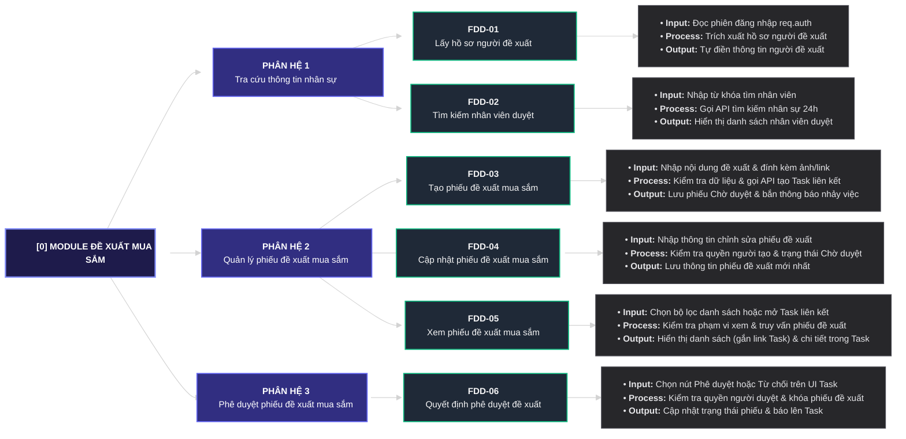

# BƯỚC 4: SƠ ĐỒ PHÂN RÃ CHỨC NĂNG (FDD 3 CẤP) & MA TRẬN RBAC — MODULE ĐỀ XUẤT MUA SẮM THIẾT BỊ

> **Tài liệu nguồn:** [`md/analysis/1-problem-survey.md`](./1-problem-survey.md), [`md/analysis/2-actor-identification.md`](./2-actor-identification.md), [`md/analysis/3-dfd-context-diagram.md`](./3-dfd-context-diagram.md)  
> **Quy chuẩn áp dụng:** [`.agents/rules/2-analysis/4_fdd_and_rbac_standard.md`](../../.agents/rules/2-analysis/4_fdd_and_rbac_standard.md)  
> **Đầu ra làm cơ sở cho:**
> - Bước 5 — Thiết kế Cơ sở Dữ liệu & Bảng Đặc tả 4 Cột (`md/analysis/db/5-database-design.md`)
> - Bước 6 — Thiết kế Tài liệu RESTful API (`md/analysis/6-api-specification.md`)

---

## 1. Đối chiếu Mã nguồn Hệ thống Hiện hữu (`suachualaptop24h` & `24hgroup_noibo`) — Các API Tích hợp Thực tế

| Hạng mục tích hợp | Cơ chế / Endpoint thực tế sử dụng | Tham chiếu mã nguồn hệ thống | Dữ liệu Input / Output thực tế |
|---|---|---|---|
| **1. Hồ sơ người đề xuất (`FDD-01`)** *(Không cần gọi API sang `EXT-01`)* | Đọc trực tiếp từ **`req.auth`** (sau middleware `requireAuthAPI`) hoặc **`res.locals.auth`** (trên SSR EJS), vốn đã được lưu trong collection `UserToken` khi đăng nhập qua `POST ${GATEWAY_API_URL_AUTH}/api/employee/auth/login-24hgroup`. | • `24hgroup_noibo/src/middlewares/auth_middleware.js` • `24hgroup_noibo/src/services/auth/auth_service.js` | Có sẵn trong `req.auth`: `_id`, `fullname` (`Employee.FullName`), `phone` (`Employee.Phone`), `group_user_name` (Chức vụ), `group_user_id`, `branch_name` (Bộ phận/Chi nhánh), `branch_id`, `image`. |
| **2. Tìm kiếm nhân viên để chọn Người duyệt (`FDD-02`)** | • **Qua Gateway `24hgroup_noibo` ➔ `suachualaptop24h`:** `GET /api/v1/auth/search?search=<keyword>&page=1&limit=20` ➔ gọi sang `GET ${GATEWAY_API_URL_AUTH}/api/employee/employee/search` (Header `token`). • *(Hoặc API nội bộ Tasks Service hỗ trợ tìm không dấu `unsign_search`: `GET /api/v1/tasks/employees/search?search=<keyword>&limit=50`)*. • **Lấy chi tiết nhiều nhân viên theo mảng `_id` (phục vụ hiển thị danh sách):** `POST /api/v1/auth/get-detail-multiple` ➔ gọi sang `POST ${GATEWAY_API_URL_AUTH}/api/employee/employee/detail-multiple` (`{ ids: JSON.stringify([...]) }`). | • `24hgroup_noibo/src/routes/api/v1/auth.js` • `suachualaptop24h/routers/ver3/api_employee.js` • `suachualaptop24h/models/Employee.js` (`search_other`) • `24hgroup_noibo/services/tasks/src/controllers/employee_controller.js` | Mảng nhân viên đang hoạt động: `_id`, `ID`, `fullname`, `phone`, `group_user_name` (Chức vụ), `group_user_id`, `branch_name` (Bộ phận/Chi nhánh), `branch_id`, `image`. |
| **3. Upload hình ảnh sản phẩm đính kèm (trong `FDD-03`, `FDD-04`)** | `POST /api/v1/upload/single?folder=purchase_requisition` (hoặc `POST /api/v1/upload/multiple?folder=purchase_requisition`) tại Gateway `24hgroup_noibo`. | • `24hgroup_noibo/src/routes/api/v1/upload.js` • `24hgroup_noibo/src/controllers/api/v1/upload_controller.js` | Nhận `multipart/form-data`, trả về `{ success: true, url, file_url, file_name, file_type, file_icon }`. |
| **4. Lấy thành viên nhóm BGĐ & Tạo Task liên kết + Bắn thông báo (`FDD-03`)** | 1. Lấy danh sách thành viên động của nhóm BGĐ theo `_id` cố định (`BGD_GROUP_ID`): **`GET /api/v1/tasks/groups/:groupId/members`**. 2. Tạo Công việc liên kết: **`POST /api/v1/tasks/tasks`** truyền `{ title, description, group_id: BGD_GROUP_ID, assignees: [approver_id], watchers: [...bgd_member_ids], purchase_requisition_id }`. *(Bên trong `task_controller.create` tự động gọi `notification_client.sendGlobalNotification` bắn App Mobile FCM + Web Push kèm `link: '/tasks?task_id=<taskId>'`)*. | • `24hgroup_noibo/services/tasks/src/routes/index.js` • `24hgroup_noibo/services/tasks/src/controllers/group_controller.js` • `24hgroup_noibo/services/tasks/src/controllers/task_controller.js` | Trả về bản ghi `Task` vừa tạo (`_id` lưu vào `PurchaseRequisition.task_id`) và tự động bắn thông báo đẩy điều hướng nhảy thẳng vào công việc đó. |
| **5. Hiển thị chi tiết & Phê duyệt ngay trong UI Tasks (`FDD-05` & `FDD-06`)** | • Danh sách phiếu đề xuất hiển thị link `/tasks?task_id=<task_id>` để nhảy thẳng vào UI Chi tiết Công việc của Module Tasks (không tạo trang UI chi tiết riêng). • Tại **`GET /api/v1/tasks/tasks/:id`**, nếu Task có trường liên kết với phiếu đề xuất thì trả kèm dữ liệu `purchase_requisition` để UI Tasks hiển thị nội dung phiếu và cụm nút **`Phê duyệt` / `Từ chối`**. • Khi duyệt/từ chối (`FDD-06`), ghi nhận hoạt động qua `activity_controller.logActivity` + `notification_client.sendGlobalNotification` để báo cho Người đề xuất vào bấm **`Hoàn thành công việc tổng`** (`PUT /api/v1/tasks/tasks/:id`). | • `24hgroup_noibo/services/tasks/src/controllers/task_controller.js` • `24hgroup_noibo/services/tasks/src/services/notification_client.js` | Tái sử dụng 100% giao diện Chi tiết Công việc, luồng Thảo luận & Thông báo sẵn có của Module Tasks. |

---

## 2. Nguyên tắc Phân rã MECE & Kiểm chứng Công thức Bảo toàn Chức năng Cấp 2

1. **Nguyên tắc MECE & Cú pháp `Động từ + Danh từ`:**
   - Chia nhánh Cấp 1 theo **Miền nghiệp vụ / Đối tượng dữ liệu cốt lõi** (không chia theo tên Actor):
     - **Phân hệ 1:** `Tra cứu thông tin nhân sự`
     - **Phân hệ 2:** `Quản lý phiếu đề xuất mua sắm`
     - **Phân hệ 3:** `Phê duyệt phiếu đề xuất mua sắm` *(tách riêng để đảm bảo Phân tách trách nhiệm — SoD)*
   - 100% các nút ở Cấp 1, Cấp 2 và Cấp 3 đều bắt đầu bằng **`Động từ + Danh từ`**.
2. **Kiểm chứng Công thức Bảo toàn Số lượng Chức năng Cấp 2:**
   - **Tổng Hành động của Actor Con người ở Bước 3:** `7` hành động (`5` của `ACT-01: Người đề xuất` + `2` của `ACT-02: Người phê duyệt`).
   - **Số Hành động trùng giữa các Actor:** `1` hành động (`[Người đề xuất - 05]` và `[Người phê duyệt - 01]` cùng là *Xem danh sách và chi tiết phiếu đề xuất mua sắm* ➔ hợp nhất thành `FDD-05`).
   - **Các tương tác với Hệ thống ngoài (`EXT-01`, `EXT-02`):** Nằm bên trong nhịp `Process` / `Output` của `FDD-02`, `FDD-03` và `FDD-06`, không tách thành chức năng người dùng trùng lặp.
   - **Số Tác vụ tự động chạy ngầm ở Bước 2:** `0`.
   > **Tổng Chức năng Cấp 2 = `7 − 1 + 0 = 6` Chức năng đơn nhiệm (`FDD-01` ➔ `FDD-06`).**

---

## 3. Sơ đồ Cây Phân rã Chức năng FDD 4 Tầng (`Cấp 0 ➔ Cấp 1 ➔ Cấp 2 ➔ Cấp 3`)

---

## 4. Bảng Đặc tả Chi tiết Tác vụ Cấp 3 (Nhịp IPO)

| Mã FDD | Tên chức năng Cấp 2 | Nhịp 1 — Input (`Động từ + Danh từ`) | Nhịp 2 — Process (`Động từ + Danh từ`) | Nhịp 3 — Output (`Động từ + Danh từ`) |
|:---:|---|---|---|---|
| **`FDD-01`** | **Lấy hồ sơ người đề xuất** | • Đọc thông tin xác thực từ `req.auth` / `res.locals.auth` khi người dùng mở form tạo đề xuất. | • Trích xuất `_id`, `fullname`, `group_user_name` (chức vụ), `branch_name` (bộ phận/chi nhánh) và gán ngày đề xuất = ngày hiện tại. | • Tự động điền thông tin người đề xuất lên biểu mẫu (không cần gọi sang `EXT-01`). |
| **`FDD-02`** | **Tìm kiếm nhân viên duyệt** | • Nhập từ khóa tìm kiếm nhân viên (`search`: họ tên hoặc số điện thoại). | • Gọi API tìm kiếm nhân sự (`GET /api/v1/auth/search` sang `suachualaptop24h` hoặc `GET /api/v1/tasks/employees/search`). | • Hiển thị danh sách nhân viên kèm chức vụ, phòng ban/chi nhánh để chọn Người duyệt (`approver_id`). |
| **`FDD-03`** | **Tạo phiếu đề xuất mua sắm** | • Nhập mảng sản phẩm (`name`, `quantity`, `image_url`/`link_url` — ảnh upload qua `POST /api/v1/upload/single`), mục đích sử dụng, tổng giá trị dự kiến, nguồn kinh phí, mảng nhà cung cấp (`name`, `description`), khoảng ngày giao `expected_delivery_from` ➔ `expected_delivery_to`, và chọn `approver_id`. | • Kiểm tra hợp lệ dữ liệu đầu vào (`expected_delivery_from <= expected_delivery_to`, tối thiểu 1 sản phẩm, số tiền $\ge 0$). • Chuẩn hóa chuỗi tìm kiếm không dấu `unsign_search`. • Gọi `GET /api/v1/tasks/groups/:bgdGroupId/members` lấy thành viên nhóm BGĐ và gọi `POST /api/v1/tasks/tasks` tạo Công việc liên kết (`assignees: [approver_id]`, `watchers: bgd_members`, `purchase_requisition_id`). | • Lưu bản ghi vào bảng `PurchaseRequisition` với trạng thái mặc định `Chờ duyệt` kèm `task_id` liên kết. • Module Tasks tự động bắn thông báo đẩy trên App/Web nhảy thẳng vào `/tasks?task_id=<task_id>`. |
| **`FDD-04`** | **Cập nhật phiếu đề xuất mua sắm** | • Nhập thông tin chỉnh sửa của phiếu đề xuất mua sắm theo `:id`. | • Kiểm tra người thao tác phải là người tạo phiếu (`proposer_id === req.auth._id`). • Kiểm tra phiếu đang ở trạng thái `Chờ duyệt` (nếu đã `Đã duyệt` hoặc `Từ chối` thì chặn `403`/`409`). • Tính toán lại chuỗi `unsign_search`. | • Lưu bản ghi `PurchaseRequisition` mới nhất và trả về dữ liệu sau cập nhật. |
| **`FDD-05`** | **Xem phiếu đề xuất mua sắm** | • Chọn bộ lọc trên màn hình danh sách (`page`, `limit`, `keyword`, `approval_status`, `from_date`, `to_date`) hoặc mở UI Chi tiết Công việc (`GET /api/v1/tasks/tasks/:id`). | • Kiểm tra phạm vi quyền xem (phiếu do mình tạo, phiếu mình được giao duyệt, hoặc thành viên nhóm BGĐ). • Truy vấn danh sách phân trang hoặc lấy chi tiết phiếu đề xuất gắn theo `purchase_requisition_id` / `task_id` (kết hợp `POST /api/v1/auth/get-detail-multiple` nếu cần lấy tên nhân sự). | • Trên UI danh sách: Hiển thị danh sách phiếu dự trù kèm link `/tasks?task_id=<task_id>` để mở thẳng chi tiết Task trên UI của Module Tasks (không tạo trang UI chi tiết mới). • Trên UI chi tiết Task: Hiển thị nội dung phiếu đề xuất và cụm nút `Phê duyệt` / `Từ chối`. |
| **`FDD-06`** | **Quyết định phê duyệt đề xuất** | • Bấm nút quyết định **`Phê duyệt`** hoặc **`Từ chối`** (kèm ghi chú/lý do nếu có) ngay trên UI Chi tiết Công việc. | • Kiểm tra người thao tác đúng là Người phê duyệt được chỉ định (`approver_id === req.auth._id`) và phiếu đang ở trạng thái `Chờ duyệt`. • Cập nhật trạng thái phiếu sang `Đã duyệt` hoặc `Từ chối` và khóa phiếu vĩnh viễn. | • Lưu trạng thái phê duyệt vào bảng `PurchaseRequisition`. • Ghi nhật ký hoạt động lên Task và bắn thông báo cập nhật cho Người đề xuất (`ACT-01`) vào Task bấm **`Hoàn thành công việc tổng`**. |

---

## 5. Ma trận Truy vết RBAC & Phân tách Trách nhiệm (Separation of Duties — SoD)

| STT | Mã FDD | Tên chức năng Cấp 2 | Nguồn Hành động / Tác vụ (Bước 2 & 3) | Bảng DB dự kiến (Bước 5) | `ACT-01`: Người đề xuất *(is_proposer)* | `ACT-02`: Người phê duyệt *(is_approver)* | Quy tắc Phân tách Trách nhiệm (SoD) & Phạm vi Dữ liệu (Scope) |
|:---:|:---:|---|---|---|:---:|:---:|---|
| 1 | **`FDD-01`** | Lấy hồ sơ người đề xuất | `[Người đề xuất - 01]` | *(Đọc trực tiếp từ `req.auth` / `UserToken`)* | `read` | — | Tự động trích xuất thông tin người đề xuất đang đăng nhập. |
| 2 | **`FDD-02`** | Tìm kiếm nhân viên duyệt | `[Người đề xuất - 02]` `[Hệ thống Nhân sự 24h - 01]` | *(Gọi API ngoài `Employee`)* | `read` | — | Tìm kiếm danh sách nhân viên đang hoạt động để chọn người duyệt. |
| 3 | **`FDD-03`** | Tạo phiếu đề xuất mua sắm | `[Người đề xuất - 03]` `[Module Tasks - 01]` | `PurchaseRequisition` *(Liên kết `Task`)* | `write` | — | Khởi tạo phiếu dự trù ở trạng thái `Chờ duyệt` và tự động sinh Task liên kết. |
| 4 | **`FDD-04`** | Cập nhật phiếu đề xuất mua sắm | `[Người đề xuất - 04]` | `PurchaseRequisition` | `write` *(Scope: đúng `proposer_id` & `Chờ duyệt`)* | — | **SoD:** Người phê duyệt không được sửa nội dung dự trù của người đề xuất; khóa sửa hoàn toàn khi đã duyệt/từ chối. |
| 5 | **`FDD-05`** | Xem phiếu đề xuất mua sắm | `[Người đề xuất - 05]` `[Người phê duyệt - 01]` | `PurchaseRequisition` *(Hiển thị chi tiết trong `Task`)* | `read` *(Scope: phiếu mình tạo / BGĐ)* | `read` *(Scope: phiếu được giao duyệt / BGĐ)* | UI danh sách gắn link mở thẳng chi tiết Task trên UI của Module Tasks. |
| 6 | **`FDD-06`** | Quyết định phê duyệt đề xuất | `[Người phê duyệt - 02]` | `PurchaseRequisition` *(Ghi log & thông báo `Task`)* | — *(Không được duyệt nếu không phải `approver_id`)* | `write` *(Scope: đúng `approver_id` & `Chờ duyệt`)* | **SoD:** Tách bạch quyền lập đề xuất dự trù (`FDD-03/04`) và quyền phê duyệt (`FDD-06`). |
