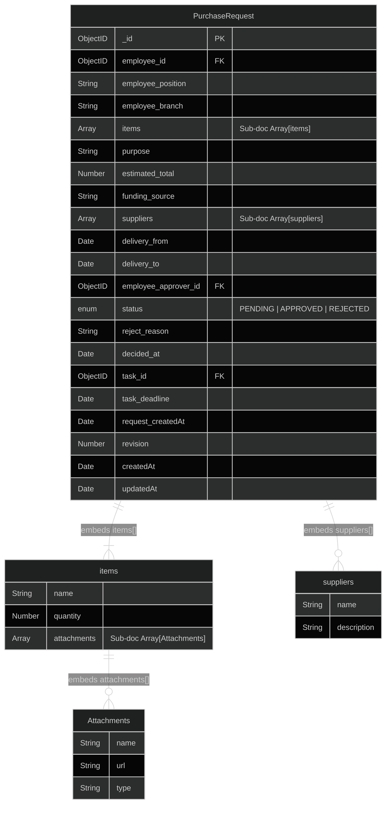

# BƯỚC 5: ÁNH XẠ FDD & ĐẶC TẢ CƠ SỞ DỮ LIỆU (DATABASE DESIGN) — MODULE ĐỀ XUẤT MUA SẮM THIẾT BỊ

> **Tài liệu nguồn:** [`1-problem-survey.md`](../1-problem-survey.md), [`2-actor-identification.md`](../2-actor-identification.md), [`3-dfd-context-diagram.md`](../3-dfd-context-diagram.md), [`4-fdd-and-rbac.md`](../4-fdd-and-rbac.md)  
> **Sơ đồ thiết kế DB đã chốt:** [`md/db/PurchaseRequest.drawio`](../../db/PurchaseRequest.drawio)  
> **Quy chuẩn áp dụng:** [`1_fdd_to_database_mapping.md`](../../../.agents/rules/3-database/1_fdd_to_database_mapping.md), [`2_db_spec_table_format.md`](../../../.agents/rules/3-database/2_db_spec_table_format.md), [`3_db_field_conventions.md`](../../../.agents/rules/3-database/3_db_field_conventions.md), [`4_db_referential_integrity.md`](../../../.agents/rules/3-database/4_db_referential_integrity.md), [`6_mongoose_and_query_rules.md`](../../../.agents/rules/3-database/6_mongoose_and_query_rules.md)  
> **Đầu ra làm cơ sở cho:** Bước 6 — Thiết kế & Tài liệu RESTful API (`md/analysis/6-api-specification.md`)

---

## 1. Ánh xạ từ Sơ đồ FDD (Bước 4) sang Thiết kế Database (Bước 5.1)

### 1.1. Ánh xạ Chức năng Cấp 2 FDD ➔ Collection & Cấu trúc Dữ liệu

| Mã FDD | Chức năng Cấp 2 (Bước 4) | Loại ánh xạ (theo Bước 5.1) | Thành phần Database tương ứng | Lý do thiết kế |
|:---:|---|---|---|---|
| **`FDD-01`** | Tạo phiếu đề xuất mua sắm | Chứng từ giao dịch ➔ **Collection độc lập** | **`PurchaseRequest`** + mảng con **`items`**, **`Attachments`**, **`suppliers`** | Khởi tạo chứng từ đề xuất ở trạng thái `PENDING` (`revision = 1`) và kích hoạt `HOOK-01`. |
| **`FDD-02`** | Cập nhật phiếu đề xuất mua sắm | Thao tác ghi trên chứng từ cha | Cập nhật trực tiếp Collection **`PurchaseRequest`** *(tăng `revision`)* | Chỉ cho phép chỉnh sửa khi `status === 'PENDING'` và đúng người tạo `employee_id`, kích hoạt `HOOK-02`. |
| **`FDD-03`** | Xem thống kê & danh sách đề xuất | Truy vấn tổng hợp & phân trang | Truy vấn **`PurchaseRequest`** *(theo `employee_id`, `employee_approver_id`, `status`, `employee_branch`)* | Tổng hợp số liệu thống kê và danh sách trên Module Đề xuất (mỗi dòng gắn link `/tasks?task_id=<task_id>`). |
| **`FDD-04`** | Khởi tạo Task & đẩy đề xuất lần đầu *(`HOOK-01`)* | Hook đồng bộ tích hợp ngoài | Cập nhật **`PurchaseRequest.task_id`** *(gọi API `Task` & `Comment` bên Module Tasks)* | Gắn kết `1-1` với Công việc duyệt đề xuất và đẩy nội dung phiếu (`revision = 1`) vào tab **Trao đổi & Thảo luận** của Task. |
| **`FDD-05`** | Đồng bộ bản sửa vào Thảo luận Task *(`HOOK-02`)* | Hook đồng bộ tích hợp ngoài | Đọc **`PurchaseRequest`** (`task_id`, `revision`) ➔ gọi API `Comment` bên Module Tasks | Đẩy nội dung bản sửa mới (`revision + 1`) thêm vào tab **Trao đổi & Thảo luận** của Task mà không sinh bảng phụ dư thừa. |
| **`FDD-06`** | Quyết định phê duyệt đề xuất trên Task | Cập nhật trạng thái chứng từ | Cập nhật **`status`**, **`decided_at`**, **`reject_reason`** trên **`PurchaseRequest`** | Ghi nhận quyết định `APPROVED` / `REJECTED` từ đúng `employee_approver_id` thao tác trên UI Task và khóa phiếu. |

> **Quyết định tổ chức Embedding vs Collection:**
> - **Collection độc lập duy nhất của module:** **`PurchaseRequest`** (tên Collection MongoDB chuẩn `PascalCase`: `{ collection: 'PurchaseRequest', timestamps: true }`).
> - **3 Bảng con nhúng (Embedded Sub-documents):** `items`, `Attachments` (nằm trong `items[].attachments`), và `suppliers` là dữ liệu chi tiết phụ thuộc hoàn toàn vào vòng đời của từng phiếu đề xuất, luôn được đọc/hiển thị cùng phiếu ➔ nhúng trực tiếp thành mảng con trong `PurchaseRequest` để truy vấn nguyên tử, không tách collection riêng.

### 1.2. Phân loại 21 Trường của `PurchaseRequest` theo 4 Nhóm Chuẩn

1. **Nhóm 1 — Định danh & Hệ thống (`5` trường):** `_id`, `status`, `revision`, `createdAt`, `updatedAt`.
2. **Nhóm 2 — Dữ liệu đầu vào từ `ACT-01` & Nhịp Input (`11` trường):** `employee_position`, `employee_branch`, `items` *(chứa `name`, `quantity`, `attachments` gồm `name`, `url`, `type`)*, `purpose`, `estimated_total`, `funding_source`, `suppliers` *(chứa `name`, `description`)*, `delivery_from`, `delivery_to`, `task_deadline`, `request_createdAt`.
3. **Nhóm 3 — Dữ liệu xử lý & quyết định từ `ACT-02` (`2` trường):** `reject_reason`, `decided_at`.
4. **Nhóm 4 — Khóa ngoại / Tham chiếu (`3` trường):** `employee_id` *(tới `Employee`)*, `employee_approver_id` *(tới `Employee`)*, `task_id` *(tới `Task` trong Module Tasks)*.

---

## 2. Sơ đồ Cấu trúc Dữ liệu & Liên kết

> **Liên kết ngoài Collection:**
> - `PurchaseRequest.employee_id` & `PurchaseRequest.employee_approver_id` tham chiếu `_id` nhân viên tại Hệ thống Nhân sự 24h (`EXT-01`).
> - `PurchaseRequest.task_id` tham chiếu `1-1` (`unique`) tới `_id` Công việc (`Task`) tại Module Tasks (`EXT-02` / `services/tasks`).

---

## 3. Bảng Đặc tả Database 4 Cột (Theo `PurchaseRequest.drawio`)

### 3.1. Collection chính: `PurchaseRequest`

- **Mongoose Collection Option:** `{ collection: 'PurchaseRequest', timestamps: true }`

| field | Type | require | Description |
|---|---|---|---|
| `_id` | `ObjectID` | `TRUE` | MongoDB tự sinh |
| `employee_id` | `ObjectID` | `TRUE` | `_id` nhân viên tạo phiếu đề xuất |
| `employee_position` | `String` | `default = ''` | Chức vụ nhân viên tạo đề xuất, mặc định lấy giá trị từ `auth.group_user_name` |
| `employee_branch` | `String` | `TRUE` | Chi nhánh mua trang thiết bị đề xuất |
| `items` | `Array` | `TRUE` | Thiết bị đề xuất mua *(cấu trúc chi tiết xem Bảng 3.2)* |
| `purpose` | `String` | `default = ''` | Mục đích sử dụng của thiết bị |
| `estimated_total` | `Number` | `Default 0` | Tổng chi phí dự kiến |
| `funding_source` | `String` | `default = ''` | Nguồn kinh phí |
| `suppliers` | `Array` | `default = []` | Danh sách nhà cung cấp *(cấu trúc chi tiết xem Bảng 3.4)* |
| `delivery_from` | `Date` | `default = null` | Ngày bắt đầu giao hàng dự kiến |
| `delivery_to` | `Date` | `default = null` | Ngày kết thúc giao hàng dự kiến (phải $\ge$ `delivery_from`) |
| `employee_approver_id` | `ObjectID` | `TRUE` | `_id` nhân viên duyệt phiếu đề xuất |
| `status` | `enum` (`String`) | `[PENDING, APPROVED, REJECTED], Default = PENDING` | Trạng thái của phiếu đề xuất |
| `reject_reason` | `String` | `default = null` | Lý do từ chối đề xuất |
| `decided_at` | `Date` | `default = null` | Thời gian `status` `[REJECTED / APPROVED]` Phiếu đề xuất thay đổi gần nhất |
| `task_id` | `ObjectID` | `TRUE` | `_id` Task duyệt đề xuất của Phiếu đề xuất này |
| `task_deadline` | `Date` | `default = null` | Hạn chót cần phê duyệt của phiếu đề xuất |
| `request_createdAt` | `Date` | `default = Date.now` | Ngày tạo đề xuất (mặc định hôm đó) |
| `revision` | `Number` | `default = 1` | Số phiên bản / lần chỉnh sửa hiện tại (mặc định `1`, tăng `+1` mỗi lần sửa) |
| `createdAt` | `Date` | `TRUE` | MongoDB tự sinh |
| `updatedAt` | `Date` | `TRUE` | MongoDB tự sinh |

> **Lưu ý khi triển khai Mongoose Schema cho `PurchaseRequest`:**
> - `items`: Trong Mongoose, `required: true` cho kiểu `Array` vẫn cho phép lưu mảng rỗng `[]`, nên cần gắn thêm custom validator `v => Array.isArray(v) && v.length > 0`.
> - `employee_position`: Tầng Service sẽ ưu tiên gán `payload.employee_position?.trim() || req.auth.group_user_name || ''`, giá trị `default: ''` trên Schema đóng vai trò lớp phòng vệ cuối.
> - `createdAt` và `updatedAt`: Bật tùy chọn Schema `{ timestamps: true }` để MongoDB/Mongoose tự sinh và tự cập nhật, không bắt Client gửi trong request body.

---

### 3.2. Bảng con 1: `items` *(Embedded Array trong `PurchaseRequest.items`)*

| field | Type | require | Description |
|---|---|---|---|
| `name` | `String` | `TRUE` | tên hàng |
| `quantity` | `Number` | `TRUE` | số lượng |
| `attachments` | `Array` | `default = []` | Đường dẫn hoặc ảnh đính kèm *(cấu trúc chi tiết xem Bảng 3.3)* |

> **Ràng buộc bổ sung:** `name` dùng `trim: true`, không cho chuỗi rỗng; `quantity` tối thiểu `>= 1` (`min: 1`).

---

### 3.3. Bảng con 2: `Attachments` *(Embedded Array trong `PurchaseRequest.items[].attachments`)*

| field | Type | require | Description |
|---|---|---|---|
| `name` | `String` | `default = ""` | tên đính kèm (mặc định để tên ảnh hoặc `"Link sản phẩm"` với link đính kèm) |
| `url` | `String` | `TRUE` | đường dẫn ảnh hoặc link |
| `type` | `String` | `TRUE` | định dạng |

> **Quy ước giá trị thực tế:**
> - Khi upload ảnh qua `POST /api/v1/upload/single?folder=purchase_requisition`: lưu `url` từ kết quả upload, `type` từ `file_type` (VD: `image` / phần mở rộng), `name` mặc định là `file_name` nếu người dùng không đặt tên.
> - Khi gắn link sản phẩm tham khảo: lưu `url` là đường dẫn URL hợp lệ (`http://` hoặc `https://`), `type` là `'link'`, `name` mặc định là `"Link sản phẩm"` nếu người dùng bỏ trống.

---

### 3.4. Bảng con 3: `suppliers` *(Embedded Array trong `PurchaseRequest.suppliers`)*

| field | Type | require | Description |
|---|---|---|---|
| `name` | `String` | `TRUE` | tên nhà cung cấp |
| `description` | `String` | `default = ""` | mô tả |

---

## 4. Quy tắc Toàn vẹn Tham chiếu, Ràng buộc Nghiệp vụ & Chiến lược Index

### 4.1. Ràng buộc Khóa ngoại & Đồng bộ Module Tasks
1. **`employee_id` (`ObjectID`, bắt buộc):** Luôn trích xuất trực tiếp từ phiên đăng nhập `req.auth._id`, tuyệt đối không tin tưởng giá trị `employee_id` gửi từ Client.
2. **`employee_approver_id` (`ObjectID`, bắt buộc):** Khi `POST` tạo mới hoặc `PUT` sửa phiếu, phải xác thực `Types.ObjectId.isValid(employee_approver_id)` và kiểm tra nhân viên tồn tại / đang hoạt động trên hệ thống Nhân sự 24h (`EXT-01`).
3. **`task_id` (`ObjectID`, bắt buộc, `unique`):**
   - Mỗi `PurchaseRequest` liên kết `1-1` với đúng 1 bản ghi `Task` trong Module Tasks (`POST /api/v1/tasks/tasks`).
   - Khi tạo phiếu mới, cần có cơ chế tạo Task trước (hoặc cập nhật liên kết / rollback bù trừ nếu bước lưu `PurchaseRequest` thất bại) để đảm bảo không sinh ra bản ghi mồ côi thiếu `task_id` hoặc Task trỏ tới phiếu không tồn tại.

### 4.2. Ràng buộc Chuyển Trạng thái & Chỉnh sửa Dữ liệu
- **Chuyển trạng thái một chiều (`PENDING` ➔ `APPROVED` | `REJECTED`):**
  - Khi mới tạo (`FDD-01` & `FDD-04`): `status = 'PENDING'`, `decided_at = null`, `reject_reason = null`, `revision = 1`.
  - Khi cập nhật nội dung (`FDD-02` & `FDD-05`): Chỉ cho phép khi `status === 'PENDING'` và `req.auth._id === employee_id`. Mỗi lần cập nhật thành công tự động tăng **`revision += 1`** và đẩy bản sửa vào Thảo luận Task qua `HOOK-02`. Nếu phiếu đã chuyển sang `APPROVED` hoặc `REJECTED` ➔ chặn với lỗi `409 CONFLICT` / `403 FORBIDDEN`.
  - Khi phê duyệt/từ chối trên Task (`FDD-06`): Chỉ cho phép `req.auth._id === employee_approver_id` và `status === 'PENDING'`.
    - Nếu chọn **`APPROVED`**: cập nhật `status = 'APPROVED'`, `decided_at = new Date()`, giữ `reject_reason = null`.
    - Nếu chọn **`REJECTED`**: cập nhật `status = 'REJECTED'`, `decided_at = new Date()`, lưu `reject_reason` từ người duyệt.
- **Kiểm tra hợp lệ đầu vào (Validation):**
  - `items` phải có ít nhất `1` phần tử; từng item phải có `name` khác rỗng và `quantity >= 1`.
  - `estimated_total >= 0`.
  - Nếu có cả `delivery_from` và `delivery_to` thì bắt buộc `delivery_to >= delivery_from` (sai trả `400 Bad Request`).

### 4.3. Chính sách Xóa bản ghi (Audit Trail)
- `PurchaseRequest` là chứng từ đề xuất mua sắm gắn trực tiếp với `Task` công việc (nơi lưu lịch sử trao đổi và thông báo của Ban Giám Đốc).
- Áp dụng quy tắc toàn vẹn tham chiếu: **Không hỗ trợ xóa cứng (`DELETE`)** bản ghi `PurchaseRequest` để bảo toàn lịch sử đối soát giữa Phiếu đề xuất và Task công việc liên quan.

### 4.4. Chiến lược Đánh Index (`MongoDB Indexes`)

| STT | Index Key(s) | Tùy chọn | Mục đích truy vấn |
|:---:|---|---|---|
| 1 | `{ task_id: 1 }` | `unique: true` | Tra cứu `1-1` `PurchaseRequest` khi người dùng mở UI Chi tiết Công việc (`/tasks?task_id=...`, `GET /api/v1/tasks/tasks/:id`). |
| 2 | `{ employee_id: 1, status: 1, createdAt: -1 }` | Compound Index | Lọc nhanh danh sách "Đề xuất của tôi" (`ACT-01`) theo trạng thái và sắp xếp mới nhất. |
| 3 | `{ employee_approver_id: 1, status: 1, createdAt: -1 }` | Compound Index | Lọc nhanh danh sách "Đề xuất cần tôi duyệt" (`ACT-02`) theo trạng thái và sắp xếp mới nhất. |
| 4 | `{ status: 1, createdAt: -1 }` | Compound Index | Hỗ trợ thành viên Ban Giám Đốc (`watchers`) lọc danh sách toàn công ty theo trạng thái và phân trang. |
| 5 | `{ employee_branch: 1, createdAt: -1 }` | Compound Index | Hỗ trợ lọc danh sách phiếu đề xuất theo chi nhánh đề xuất mua sắm. |
